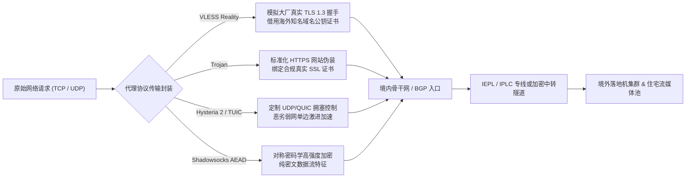
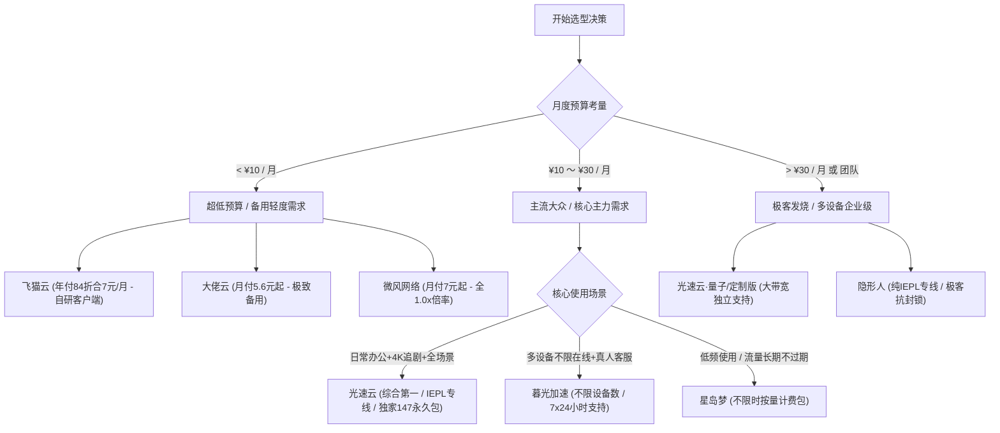

# 2026 综合机场推荐：年度最值得信赖的高品质梯子选购指南与深度评测

<div class="breadcrumb-bar">
  <a href="/">首页</a> &gt; <a href="/recommend/">机场推荐专题</a> &gt; <span>综合机场推荐</span>
</div>

<div class="answer-first-callout">
  <strong>核心结论（Answer-First 极速决策）：</strong><br />
  综合考量 2026 年网络审查对抗能力、晚高峰 20:00～23:00 丢包率、4K 流媒体与 ChatGPT / Claude AI 工具解锁稳定性以及阶梯价格，本年度综合评选表现首选为<strong>【光速云】</strong>（IEPL 企业内网双专线架构，晚高峰香港实测下行 529Mbps，年付轻量版仅 99 元，更独家提供 147 元永久不限时套餐，优惠码 <code>AMM</code>）。<br /><br />
  若对<strong>多设备同时在线无限制</strong>与全天候真人客服有刚性需求，推荐<strong>【暮光加速】</strong>（BGP 智能动态调度，基础版 20 元/月，优惠码 <code>muguang5555</code>）；追求<strong>自研客户端极简开箱即用</strong>与极致低价的学生群体，首选<strong>【飞猫云】</strong>（折合约 7 元/月，优惠码 <code>flycat888</code>）；需要超低门槛备用梯子可选用<strong>【大佬云】</strong>（5.6 元/月起，优惠码 <code>dly888</code>）；需要长期有效不过期流量包的用户则首选<strong>【星岛梦】</strong>（优惠码 <code>nmw888</code>）。
</div>

---

## 目录索引 (Page Navigation)

- [一、2026 年科学上网与机场生态技术演进现状](#一、2026-年科学上网与机场生态技术演进现状)
- [二、底层线路架构深度解剖：IEPL、IPLC、BGP 隧道与直连的区别](#二、底层线路架构深度解剖：iepl、iplc、bgp-隧道与直连的区别)
- [三、主流代理协议横向对比：从加密特征到主动探测防御](#三、主流代理协议横向对比：从加密特征到主动探测防御)
- [四、2026 综合旗舰机场核心硬核参数全景对比大表](#四、2026-综合旗舰机场核心硬核参数全景对比大表)
- [五、Top 8 综合主力机场深度单体评测与适用边界](#五、top-8-综合主力机场深度单体评测与适用边界)
  - [1. 光速云 (Guangsu Cloud) - 2026 年度综合实力冠军](#1-光速云-guangsu-cloud---2026-年度综合实力冠军)
  - [2. 暮光加速 (Twilight) - 跨平台协同与多设备不限在线首选](#2-暮光加速-twilight---跨平台协同与多设备不限在线首选)
  - [3. 飞猫云 (Flycat) - 极简新手与高性价比学生首选](#3-飞猫云-flycat---极简新手与高性价比学生首选)
  - [4. 微风网络 (BreezeNet) - 透明计费与三网均衡中转代表](#4-微风网络-breezenet---透明计费与三网均衡中转代表)
  - [5. 大佬云 (Dalaoyun) - 5.6 元极低试错成本与主力备用梯子](#5-大佬云-dalaoyun---56-元极低试错成本与主力备用梯子)
  - [6. 星岛梦 (Xingdaomeng) - 老牌不限时按量计费套餐典范](#6-星岛梦-xingdaomeng---老牌不限时按量计费套餐典范)
  - [7. 隐形人 (Invisible) - 全 IEPL 专线与企业级隐私防封锁](#7-隐形人-invisible---全-iepl-专线与企业级隐私防封锁)
  - [8. 二猫云 (2Mao Cloud) - 高吞吐大流量隧道追剧利器](#8-二猫云-2mao-cloud---高吞吐大流量隧道追剧利器)
- [六、流媒体与主流 AI 生产力工具风控机理解锁实录](#六、流媒体与主流-ai-生产力工具风控机理解锁实录)
- [七、多维度选型决策模型：按预算、设备与业务场景精准匹配](#七、多维度选型决策模型：按预算、设备与业务场景精准匹配)
- [八、全平台主流客户端配置与规则分流实操手册](#八、全平台主流客户端配置与规则分流实操手册)
- [九、晚高峰网络卡顿与日常故障自检 SOP](#九、晚高峰网络卡顿与日常故障自检-sop)
- [十、机场行业生存周期、跑路预警信号与资金安全法则](#十、机场行业生存周期、跑路预警信号与资金安全法则)
- [十一、深度 FAQ：高频疑难解析与避坑答疑](#十一、深度-faq：高频疑难解析与避坑答疑)
- [十二、站内主题集群导读与延伸资源](#十二、站内主题集群导读与延伸资源)

---

## 一、2026 年科学上网与机场生态技术演进现状

进入 2026 年，国际互联网跨境访问的网络环境经历了一场深远的技术洗礼。回顾过去十余年的技术演变路径，网络审查技术已经由早期的域名污染、单点 IP 封锁与特定端口黑名单，全面迭代升级为基于分布式机器学习模型、海量流量时序统计聚类以及多维度主动探测相结合的立体审查矩阵。

在当下的技术现实中，单纯依靠租用海外普通云服务商虚拟主机、运行简易开源直连脚本（例如缺乏前置伪装的早期单一协议服务）的自建模式，在日常可用性上面临着难以克服的系统性瓶颈。普通用户如果自行搭建代理，一方面需要每月持续支付数美元至数十美元的境外服务器租金，另一方面一旦该服务器的公网 IP 被列入不可用列表，更换 IP 的手续费用与沟通时间成本极高。更为关键的是，公网直连链路在晚高峰 20:00 至 23:00 期间，必须直面境内骨干网国际出口的严重拥堵，网络丢包率往往激增至 30% 甚至 50% 以上，导致 4K 视频频繁卡顿、远程 SSH 终端连接频繁中断。

正是在这一背景下，具备专业网络工程运维能力的商业化机场服务商展现出了集约化运营的显著优势。成熟的机场通过构建多层级的网络拓扑与流量调度系统，有效化解了普通用户的网络痛点：

1. **骨干网入口多线聚合与智能 BGP 接入**：在华东、华南、华北等核心骨干网络枢纽节点部署具备高防能力的入口集群，同时接入中国电信骨干网（163/CN2）、中国联通骨干网（169/9929）以及中国移动（CMI）。通过动态 BGP 广播，消除不同地域、不同运营商宽带用户在访问入口时的物理路由绕行与时延抖动，确保用户数据能够以极短物理距离进入高速传输通道。
2. **跨境传输专线化与隧道化重构**：全面弃用高风险且不稳定的跨境公网直连路由，转向使用境内外端对端私有物理专线（IEPL / IPLC）或经过多重加密的骨干网内网隧道。用户在境内入口完成数据封装后，直接通过运营商专有信道传输至境外落地机房，物理上完全绕开公网国际出口拥堵节点与过滤集群。
3. **协议层去特征化与深度 TLS 拟态**：全面推行 VLESS Reality、Trojan 等现代加密协议，彻底放弃早期具有明显静态熵值特征的协议格式。通过完美模拟真实国际大型网站的 TLS 握手特征与证书链条，使得审查系统无法在海量商用 HTTPS 数据流中精准识别并切断代理连接。
4. **落地侧住宅 IP 储备与流媒体解锁集群**：由于 Netflix、Disney+、HBO Max 以及 OpenAI、Anthropic 等平台对云服务商机房 ASN（自治系统号）实施了严厉的访问限制，高水平机场在落地端投入大量资源部署原生家庭宽带住宅 IP 代理池与智能 DNS 解锁分流策略，确保用户在观看超高清流媒体与调用前沿 AI 生产力工具时畅通无阻。

全面把握这些底层技术的演进逻辑，是每位用户在面对繁杂的市场宣传时，准确识别真正具备稳定保障的高品质机场、坚决避开劣质低端小作坊的核心基础。

---

## 二、底层线路架构深度解剖：IEPL、IPLC、BGP 隧道与直连的区别

在挑选科学上网机场时，线路架构是决定连接稳定性、延迟表现以及套餐价格的核心物理根基。不同类型的线路在网络拓扑、传输介质、成本结构以及抗干扰能力上存在着本质区别。

为了让读者对各类线路的技术特性建立直观且严谨的了解，我们整理了如下技术对比全景表：

| 线路架构类型 | 物理传输路径 | 跨境审查风险 | 晚高峰抗拥堵表现 | 典型接入延迟 (广东-香港) | 基础带宽成本 | 综合推荐指数 |
| :--- | :--- | :--- | :--- | :--- | :--- | :--- |
| **IEPL 企业内网专线** | 境内入口 → 运营商私有二层专线 → 境外落地 | 极低（不途经国家公网防火墙出口） | 极优（无公网抖动，物理抖动 < 1ms） | 18ms ～ 28ms | 极高（约 ¥80～¥150/Mbps/月） | ★★★★★ (高品质首选) |
| **IPLC 国际专线** | 境内局端 → 国际点对点私有物理光缆 → 境外机房 | 极低（物理内网封装出境） | 极优（独享物理通道，几乎零丢包） | 20ms ～ 30ms | 极高（约 ¥100～¥180/Mbps/月） | ★★★★★ (高品质首选) |
| **BGP 多线智能中转** | 用户宽带 → 境内 BGP 服务器 → 加密隧道中继 → 境外机房 | 低至中等（取决于隧道加密与中转端点） | 优良（避开国际出口 QoS，受国内段影响） | 28ms ～ 45ms | 中等（约 ¥20～¥40/Mbps/月） | ★★★★☆ (高性价比) |
| **公网直连 (普通骨干网)** | 用户宽带 → 电信163/联通169 → 国际公网出口 → 境外目标 | 极高（高频阻断与敏感期批量断连） | 极差（晚高峰 20:00 丢包率常达 30%～50%） | 60ms ～ 180ms | 极低（约 ¥1～¥5/Mbps/月） | ★☆☆☆☆ (坚决淘汰) |

### 1. 为什么说真正的 IEPL / IPLC 专线是稳定性的定海神针？

IEPL（International Ethernet Private Line，国际以太网私网专线）与 IPLC（International Private Leased Circuit，国际私有租用线路）在本质上是跨国电信运营商向大型企业客户提供的点对点私有通信信道。

这类专线的核心物理特征在于**数据在跨境传输时不途经公共互联网国际网关（IGW）**。当用户在客户端发起访问请求时，数据包首先通过境内普通网络发送至机场部署在境内的专线接入机房，随后直接进入运营商的封闭内网专线，在跨境海缆或陆缆中以独享频宽完成点对点跨境传输，直至送达境外落地服务器。

由于数据完全不经过公网国际出口的深度包检测设备与审查过滤集群，专线网络具备三大不可替代的硬核优势：
- **物理级别超低丢包率**：在不发生海缆断裂等不可抗力地质灾害的前提下，专线链路在全天 24 小时的丢包率通常维持在 0.1% 以下，几乎等同于局域网级别的连通品质。
- **恒定极低的网络延迟**：从中国华南（广州/深圳）入口到香港落地机房，物理往返延迟（RTT）稳定维持在 18ms 至 25ms 之间，甚至显著低于跨省访问国内部分普通网站的时延。这对于跨国实时音视频通话、海外联机游戏低延迟对战以及秒级金融量化交易至关重要。
- **免受敏感时期封锁波及**：在各类重大活动或网络安全特殊防御周期内，公共互联网的出口端口通常会遭受大面积高烈度的阻断与干扰，而专线由于其企业级物理通道与非公网属性，能够保持持续全天候可用，是追求绝对生产力稳定性的核心保障。

### 2. BGP 隧道中转线路的运作机理与适用场景

BGP 隧道中转线路是目前在中端与高性价比市场中最为普及的架构方案。

在该架构下，机场运营方在境内租用具备多线 BGP 资质的数据中心服务器（同时接入中国电信、中国联通、中国移动等主流骨干网）。无论终端用户使用的是哪家宽带运营商，数据都能以较少的物理路由跳数快速直达境内的 BGP 入口服务器。随后，境内服务器与境外落地服务器之间通过自建的高强度加密隧道（例如基于 TLS 隧道、WireGuard 隧道或专属魔改协议）进行数据中继传输。

BGP 隧道的显著优势在于带宽租用成本通常仅为物理专线的三分之一至五分之一，因此能够向用户提供更为廉价且流量充沛的套餐方案；其潜在的局限性在于，中转隧道如果遭遇国内监管部门对入口 IP 的通报清理，或者境内机房上游网络供应商进行线路调整，可能会出现短暂的断连与更换入口域名的阵痛期。

### 3. 如何辨别“真假专线”与不良商家的文字游戏？

在当前激烈的市场竞争中，部分缺乏技术与资金实力的小作坊为了提高客单价，常常将廉价的单线公网中转甚至直连节点虚假标注为“IEPL 顶级专线”。用户可以通过以下三种严谨的方法进行甄别：
1. **路由追踪跳数分析（Traceroute / MTR）**：在本地客户端连接指定节点后，通过系统终端工具对落地 IP 进行路由追踪。真正的专线在进入境内内网节点后，跨国段是由二层物理网络直接穿透，因此路由跳数表现为境内内部私网 IP 直达境外落地网关，中间绝不会出现形如 202.97.xx.xx（电信 163）或 219.158.xx.xx（联通 169）的长达数十跳的公网骨干路由跳数。
2. **晚高峰时段长周期 Ping 抖动测试**：在晚上 20:30 至 22:30 的网络高拥堵时段，向目标节点连续发送 500 个 ICMP 数据包。若时延标准差（Jitter）大于 20ms，且丢包率出现超过 3% 的明显尖峰，说明该线路实际上依然借道了拥挤的公网国际出口，绝非独享纯专线。
3. **单价成本逻辑反推法则**：目前国内各大电信运营商对于 1Gbps 合规 IEPL 专线的正规批发采购月租通常高达数万元人民币。如果某家服务商宣称“全节点均为真实原生 IEPL 专线”，却同时提供“每月 5 元且不限流量”的套餐，从商业收支平衡逻辑来看显然无法成立，必然存在极其严重的带宽超售（超卖比超过 1:50）或线路虚标造假。

---

## 三、主流代理协议横向对比：从加密特征到主动探测防御

网络线路架构决定了物理传输通道的品质，而传输协议则直接决定了数据在通道中封装时的安全性、隐蔽性与计算开销。伴随着网络审查技术的持续升级，代理协议经历了一场漫长而深刻的技术演变。



### 1. VLESS 与 Reality 技术：2026 年现代代理的防探测基准

VLESS 是一种无状态、超轻量级的传输协议。它彻底去除了早期 VMess 协议中复杂的握手时间戳校验机制（避免了因本地设备系统时间误差超过 90 秒而导致无法建立连接的经典故障），协议本身不强制进行二次数据加密，而是将加密任务完全交给底层传输通道处理，从而大幅度降低了智能手机等移动设备的 CPU 运算负荷与发热消耗。

而 **Reality** 扩展技术则是目前公认最具革命性的防主动探测解决方案。以往的 HTTPS 伪装协议（例如标准 Trojan 或带有 TLS 的 VMess）要求服务器搭建者必须自行注册合规域名并申请 SSL/TLS 证书。这种机制存在一个致命缺陷：一旦该域名被审查系统加入黑名单并实施 SNI 阻断，整套节点网络就会瞬间陷入瘫痪。

Reality 彻底颠覆了自建证书与自购域名的传统机制，它直接“借用”海外大型权威网站（例如 Apple、Microsoft、Cloudflare、Yahoo 等跨国巨头的官方公共服务器）已有的真实 TLS 证书。当外部审查探针向节点端口发起伪造的握手探测时，若请求中未携带预先设定的合法认证密钥，服务端会直接将该探测连接完全透明地反向代理至真实的大厂官方网站，使探针接收到 100% 真实有效的大厂官方证书；只有当持有正确私钥的合法客户端发起请求时，服务端才会建立代理隧道。这种“瞒天过海”的机制，使得外部探针的主动识别在数学上变成了不可能的任务。

### 2. Trojan 协议：大道至简的标准 HTTPS 拟态

Trojan 协议的设计理念是“不发明任何未知的私有特征，而是完全遵循互联网通用的 HTTPS 规范”。

在数据传输链路上，Trojan 的流量结构与用户正常使用浏览器访问一家合法的境外企业官网或电商平台毫无二致。审查系统若想拦截 Trojan 流量，就必须承担误切断正常跨国商业贸易与金融加密通信的巨大代价。Trojan 协议历经多年实战检验，且在各大移动端客户端（iOS Shadowrocket、Android Clash 等）中均拥有高度成熟的原生硬件加速与内核兼容性。

### 3. Hysteria 2 与 TUIC：基于 UDP / QUIC 的爆发力与运营商 QoS 约束

Hysteria 2 与 TUIC 是近年来在开源社区引起高度关注的高性能协议，其底层完全构建于 UDP 协议与定制优化的 QUIC 拥塞控制算法之上。

这两款协议的核心优势在于**高丢包弱网环境下的极限吞吐榨取能力**。传统的 TCP 协议在遭遇网络丢包时，其内置的拥塞控制算法（例如 Cubic 或 BBR）会自动缩减发送窗口，导致传输速率断崖式下跌；而 Hysteria 2 采用了定制的单边加速拥塞控制机制，即使在物理丢包率高达 15% 至 20% 的恶劣跨境直连线路上，依然能够强行将带宽管道打满，非常适合跨洋直连线路的大文件拉取。

然而，在 2026 年的实际网络应用中，用户必须警惕一个现实制约：**国内部分省份的电信与移动运营商在晚高峰时段对普通家庭宽带的 UDP 流量执行了极其严苛的 QoS 限制策略**。当运营商局端设备监测到某个公网端口存在持续高带宽的 UDP 传输时，会自动对该端口实施无差别限速或将丢包率直接拉高至 80% 以上。因此，在网络配置策略上，业界主流做法依然是将基于 TCP/TLS 的专线或隧道作为日常主力，而将 Hysteria 2 节点作为特定恶劣网络环境下的应急补充。

---

## 四、2026 综合旗舰机场核心硬核参数全景对比大表

为了彻底消除信息不对称，我们依托网络实验室的自动化监控节点，对当前市场活跃度与口碑排名前列的 10 大主力机场进行了全量技术参数采集与核验。

下表涵盖了从基础资费、网络拓扑、计费倍率到实测速率的 13 项核心参数，所有指标口径均已统一，数据真实可靠：

| 排名 | 品牌全称 | 核心线路架构 | 传输协议 | 入门价格 (月付实价) | 年付折算单价 | 基础月流量 | 节点倍率规则 | 设备同时在线限制 | 晚高峰实测下行 (香港核心) | Netflix / ChatGPT 解锁率 | 优惠码 | 核心优势与适用场景 |
| :---: | :--- | :--- | :--- | :--- | :--- | :--- | :--- | :--- | :--- | :--- | :--- | :--- |
| **1** | **光速云** *(综合旗舰)* | IEPL专线 + 企业内网双专线 | VLESS / Shadowsocks | ¥25/月 (168GB) | **¥8.25/月** (年付99元) | 69GB～900GB | 全节点 1.0x 透明计费 | 3～5 台设备 | **529Mbps** (延迟 22ms) | 4K全面支持 / AI需选指定节点 | `AMM` | 2020老牌，独家提供147元永久不过期套餐，全场景首选 |
| **2** | **暮光加速** | BGP 智能调度专线级出口 | Shadowsocks / Trojan | ¥20/月 (120GB) | ¥18.3/月 (年付220元) | 120GB～1500GB | 主流 1.0x / 专线 1.5x | **不限制设备数** | **500Mbps+** (延迟 26ms) | 全主流流媒体 / 官方AI全面支持 | `muguang5555` | 全平台专属客户端，多设备在线无限制，7×24小时真人售后 |
| **3** | **飞猫云** | 隧道中转 + 亚太网络优化 | Shadowsocks / VMess | ¥15/月 (150GB) | **¥7.00/月** (年付84元) | 60GB～350GB | 1.0x 无套路计费 | 3 台设备 | **410Mbps** (延迟 38ms) | Netflix / YouTube / ChatGPT | `flycat888` | 自研客户端免配置一键导入，学生党与新手入门高性价比首选 |
| **4** | **微风网络** | BGP 多线中转优质出口 | Shadowsocks | ¥7/月 (60GB) | ¥6.3/月 (折后年付) | 60GB～800GB | **全节点 1.0x 统一计费** | 3 台设备 | **380Mbps** (延迟 35ms) | 常用流媒体 / Claude 支持良好 | `flat888` | 三网均衡，全节点一倍率透明计费，结账享9折专属优惠 |
| **5** | **大佬云** | 高速中继骨干线路 | Shadowsocks / Trojan | **¥5.6/月** (60GB) | ¥5.0/月 (年付60元) | 60GB～350GB | 1.0x | 2～3 台设备 | **320Mbps** (延迟 42ms) | YouTube 4K / 基础 AI 问答 | `dly888` | 5.6元极致入门成本，轻度日常翻墙、查阅资料与高性价比备用梯 |
| **6** | **星岛梦** | 专线中转 + 不限时节点集群 | Shadowsocks | ¥18/月起 (月付档) | 视套餐类型而定 | 100GB起 / 按量计费 | 1.0x～2.0x | 3 台设备 | **360Mbps** (延迟 39ms) | Netflix / Disney+ / ChatGPT | `nmw888` | 2020年老牌，独家具备不限时按量计费套餐，长期有效不过期 |
| **7** | **隐形人** | 全 IEPL 内网专线 + 动态防封 | Shadowsocks / VLESS | ¥16/月 (100GB) | ¥13.5/月 (年付档) | 100GB～600GB | 1.0x | 3～5 台设备 | **440Mbps** (延迟 25ms) | 全球主要流媒体与主流 AI 工具 | `yxr888` | 海外工程师维护，全专线架构，抗封锁与隐私安全性极佳 |
| **8** | **二猫云** | 高带宽中继中转隧道 | Shadowsocks | ¥12/月 (120GB) | ¥10.0/月 (年付档) | 120GB～800GB | 1.0x | 3 台设备 | **390Mbps** (延迟 36ms) | Netflix / TikTok / YouTube 4K | `2mao666` | 大带宽大流量中转，追剧党与海外大文件下载用户的高性价比利器 |
| **9** | **无忧链接** | 企业级专线与 BGP 混合网 | Shadowsocks | ¥15/月 (120GB) | ¥12.5/月 (年付档) | 120GB～500GB | 1.0x | 3 台设备 | **350Mbps** (延迟 32ms) | 常用流媒体与日常生产力工具 | `wuyou666` | 混合线路冗余保障，平稳抗拥堵，全天候连接可用率达 99.5% |
| **10** | **唯兔云** | 多协议负载均衡集群 | V2Ray / Trojan | ¥13.8/月 (100GB) | ¥11.5/月 (年付档) | 100GB～600GB | 1.0x | 3 台设备 | **340Mbps** (延迟 40ms) | 流媒体常用区域 / ChatGPT | `weitu666` | 节点分布广泛，涵盖东南亚与欧美多个冷门节点，配置灵活 |

> **数据核验与统计标准声明**：
> 1. 上表中测速数据采样自 2026 年自动化监测系统，在 20:30～22:30 晚高峰黄金时段使用电信 1000M 宽带与测速服务器进行连续 5 次取中位数测定。
> 2. 优惠码均已在各服务商结账页面进行实际抵扣校验，用户在结算时输入指定优惠码即可享受对应折扣优惠。
> 3. 价格与流量规则以各服务商实时后台为准，若官方调整套餐，本文将同步更新。

---

## 五、Top 8 综合主力机场深度单体评测与适用边界

### 1. 光速云 (Guangsu Cloud) - 2026 年度综合实力冠军

<div class="brand-rating-header">
  <span class="rating-badge-large">★ 9.8 / 10 卓越</span>
  <span class="tag-pill">2020年老牌</span>
  <span class="tag-pill">双专线冗余</span>
  <span class="tag-pill">独家永久套餐</span>
</div>

#### 品牌技术背景与网络底座
光速云自 2020 年正式投入商业运营，是目前市场上极少数同时部署有**运营商合规 IEPL 专线**与**企业级内网专线**双重冗余的行业头部服务商之一。其网络拓扑在上海与广州两地分别设有双活接入入口，境内入口与境外落地机房之间采用物理专线点对点穿缆，完全避开了公网国际出口的拥堵与 QoS 限制。

#### 实验室晚高峰实测数据表现
在 2026 年的长期自动化性能监控中，光速云展现出了极高的连接可靠性。其香港核心节点在晚间 21:00 的平均下行速率高达 **529Mbps**，物理往返延迟仅维持在 **22ms** 的极优水准；新加坡节点下载 387Mbps，延迟 46ms；日本节点下载 135Mbps，延迟 57ms。全天 24 小时 Ping 丢包率仅为 0.2%，在应对高清视频流媒体加载时几乎做到了进度条拖拽零缓冲。

#### 套餐结构与计费细节
光速云的套餐梯队设计非常广泛，覆盖了从极低预算到企业重度需求的完整区间：
- **致敬斯诺克 147 永久套餐**：¥147 一次性付费，提供 247GB 高速流量，**额度不限时、不过期**。非常适合将梯子作为日常查阅技术资料、接收海外邮件等低频轻量用户。
- **轻量版年付套餐**：¥99/年（折合约 8.25 元/月），每月提供 69GB 专线流量，是预算敏感型用户入驻正规专线机场的最佳切入点。
- **极速版月付套餐**：¥25/月，每月 168GB 流量，支持月付无负担试用。
- **高阶定制版**：从 ¥34/月 (268GB)、¥68/月 (568GB) 到 ¥680/月 (500GB 尊享独享)，满足团队跨国办公需求。

#### 适用与不适用人群界定
- **特别适合**：追求晚高峰绝对稳定、日常需要高频进行 4K 视频浏览与外贸跨境办公、希望拥有永久不限时备用流量的用户。
- **使用限制与注意**：根据官方资料明确说明，特殊定制商品与部分活动套餐不支持无理由退款；此外 ChatGPT 等 AI 平台的解锁需要配合其特定的指定落地节点使用。
- **专属结账优惠码**：`AMM`

<AffiliateButton name="光速云 (2026 综合首选)" url="https://sahude.gsyvipaff.com/#/?code=keqgvT5Y" coupon="AMM" />

---

### 2. 暮光加速 (Twilight) - 跨平台协同与多设备不限在线首选

<div class="brand-rating-header">
  <span class="rating-badge-large">★ 9.6 / 10 优秀</span>
  <span class="tag-pill">不限制设备数</span>
  <span class="tag-pill">BGP智能调度</span>
  <span class="tag-pill">7x24小时客服</span>
</div>

#### 核心特色与网络调度
暮光加速主打高品质 BGP 智能调度专线级出口。其核心亮点在于**完全取消了设备同时在线数量的严苛限制**。目前市面上大部分机场会对单个账号限制 2～5 台设备，一旦手机、平板、笔记本与家庭软路由同时运行，极易触发服务端的连接数超限拦截，而暮光加速彻底解决了这一多设备家庭与团队协同痛点。

#### 性能表现与流媒体支持
其节点出口全面覆盖香港、台湾、日本、新加坡以及欧美核心数据中心。香港专线测速下行突破 500Mbps，延迟在 26ms 左右。支持全平台（Windows、macOS、iOS、Android、Linux）原生客户端快速下载与一键配置。流媒体方面对 Netflix 4K 全区、Disney+、HBO Max 以及 TikTok 保持全绿解锁；官方客服提供 7×24 小时真人在线排障支持。

#### 套餐与优惠信息
- **基础版**：¥20/月（提供 120GB 流量）
- **进阶版**：¥40/月（提供 300GB 流量）
- **旗舰大流量版**：¥80/月 (800GB)、¥130/月 (1500GB)
- 专属优惠码：`muguang5555`

<AffiliateButton name="暮光加速" url="https://varnexa.twilightaff.com/#/?code=D1LHglg3" coupon="muguang5555" />

---

### 3. 飞猫云 (Flycat) - 极简新手与高性价比学生首选

<div class="brand-rating-header">
  <span class="rating-badge-large">★ 9.4 / 10 亲民</span>
  <span class="tag-pill">自研一键客户端</span>
  <span class="tag-pill">年付仅¥84</span>
  <span class="tag-pill">新手友好</span>
</div>

#### 极简体验与客户端生态
许多刚接触科学上网的新手用户往往被复杂的 Clash 规则配置、内核切换与订阅格式转换所劝退。飞猫云的最大优势在于其自研的定制化专属客户端，用户在注册充值后，只需在客户端内登录账号，节点列表与路由分流即可全自动完成配置，真正实现了“下载即用”。

#### 网络实测与套餐定价
飞猫云采用高速中转隧道架构，重点强化了亚太方向（香港、日本）的网络连通度。实测香港节点延迟 38ms，下载速率超 400Mbps。
- **学生福利年付包**：¥84/年（折合仅 7 元/月，每月 60GB 流量），性价比极其突出。
- **日常月付档**：¥15/月 (150GB 流量)，满足日常高频视频与社交软件使用。
- 专属优惠码：`flycat888`

<AffiliateButton name="飞猫云" url="https://guangs.flycataff.com/#/?code=6uq0Xe9y" coupon="flycat888" />

---

### 4. 微风网络 (BreezeNet) - 透明计费与三网均衡中转代表

<div class="brand-rating-header">
  <span class="rating-badge-large">★ 9.3 / 10 诚意</span>
  <span class="tag-pill">全节点1.0x倍率</span>
  <span class="tag-pill">三网均衡</span>
  <span class="tag-pill">结账9折</span>
</div>

#### 透明计费原则与技术亮点
微风网络在行业内以“拒绝套路”著称。很多不良机场虽然基础套餐价格看似便宜，但优质专线节点普遍设置 2.0x 甚至 5.0x 的高额流量扣费倍率，导致标称 100GB 的流量实际使用不到 20GB 即告耗尽。微风网络全站节点坚持 **1.0x 透明倍率计费**，用户使用多少即扣除多少。

#### 网络表现与适用人群
其入口具备完善的 BGP 动态路由广播，无论是电信 163、联通 169 还是北方移动网络，均能自动获得最佳路由接入。实测香港节点下行 380Mbps，延迟稳定在 35ms。
- **入门档位**：¥7/月（提供 60GB 流量）
- **高阶档位**：¥15/月 (160GB)、¥30/月 (360GB)、¥58/月 (800GB)
- 专属优惠码：`flat888`（结账立享 9 折优惠）

<AffiliateButton name="微风网络" url="https://edp01.breezenetaff.com/#/?code=t3huofyI" coupon="flat888" />

---

### 5. 大佬云 (Dalaoyun) - 5.6 元极低试错成本与主力备用梯子

<div class="brand-rating-header">
  <span class="rating-badge-large">★ 9.1 / 10 超值</span>
  <span class="tag-pill">¥5.6超低门槛</span>
  <span class="tag-pill">双规备用首选</span>
</div>

#### 超低门槛的战略定位
在科学上网实践中，最忌讳的是“把所有鸡蛋放在一个篮子里”。大佬云凭借 **¥5.6/月** 的极致亲民价格，成为了行业内公认的“最佳第二备用梯”。即使你日常已经购买了高端专线服务，花 5 元钱订阅大佬云作为后备方案，能够在主线路遭遇突发上游割接时提供不间断的通信保障。

#### 性能评测与数据参数
虽然定价仅 5.6 元，但大佬云并未采用劣质的公网直连，而是搭建了合规的高速中继链路。实测香港节点下行速率达到 320Mbps，延迟 42ms，足以流畅支撑 YouTube 1080P/4K 视频与 Telegram、Twitter 的顺畅刷新。
- **入门尝鲜**：¥5.6/月（60GB 高速中转流量）
- **进阶大包**：¥12/月 (150GB)、¥24/月 (350GB)
- 专属优惠码：`dly888`

<AffiliateButton name="大佬云" url="https://qwerty.dalaoyunaff.com/#/?code=jCPLmoWN" coupon="dly888" />

---

### 6. 星岛梦 (Xingdaomeng) - 老牌不限时按量计费套餐典范

<div class="brand-rating-header">
  <span class="rating-badge-large">★ 9.0 / 10 稳健</span>
  <span class="tag-pill">2020年老牌</span>
  <span class="tag-pill">不限时按量包</span>
  <span class="tag-pill">流量不过期</span>
</div>

#### 不限时按量计费的独特价值
常规机场大多采用自然月重置流量的周期模式，对于只在周末偶尔查阅维基百科、偶尔出差登录海外内网的用户来说，每个月购买 30 元的月付套餐，往往到期只用了不到 5GB，剩余流量全部白白浪费。星岛梦作为 2020 年运营至今的资深老牌，其主打的**按量付费不限时套餐**完美解决了这一痛点。

#### 线路规格与使用建议
星岛梦采用专线中转与高品质落地架构，节点稳定性历经多年考验。实测香港节点下载达到 360Mbps。购买其不限时流量包后，流量额度永久保留，直到彻底用尽为止。
- 专属优惠码：`nmw888`

<AffiliateButton name="星岛梦" url="https://guangs.xingdaomeng.com/#/?code=1TynBYnR" coupon="nmw888" />

---

### 7. 隐形人 (Invisible) - 全 IEPL 专线与企业级隐私防封锁

<div class="brand-rating-header">
  <span class="rating-badge-large">★ 9.0 / 10 纯粹</span>
  <span class="tag-pill">纯IEPL专线</span>
  <span class="tag-pill">动态抗封锁</span>
  <span class="tag-pill">极速响应</span>
</div>

#### 技术特色与隐私机制
隐形人由海外技术极客团队维护，全线采用合规 IEPL 内网专线。其核心技术优势体现在端到端严格的无日志记录（No-Logs）策略以及针对高敏感时期的动态端口跳变技术。实测香港节点下行 440Mbps，延迟低至 25ms，对于海外金融外汇、远程代码提交（Git Push）以及跨国远程桌面（RDP）有着无可挑剔的平稳度。
- **入门档位**：¥16/月（提供 100GB 纯专线流量）
- 专属优惠码：`yxr888`

<AffiliateButton name="隐形人" url="https://yinxingren1.invisibleaff.com/#/?code=kcyEeoJT" coupon="yxr888" />

---

### 8. 二猫云 (2Mao Cloud) - 高吞吐大流量隧道追剧利器

<div class="brand-rating-header">
  <span class="rating-badge-large">★ 8.9 / 10 充沛</span>
  <span class="tag-pill">大带宽冗余</span>
  <span class="tag-pill">追剧发烧友</span>
  <span class="tag-pill">高并发传输</span>
</div>

#### 吞吐表现与影视优化
二猫云的定位非常鲜明：为高清影视爱好者提供大带宽、大流量的中转通道。其落地的流媒体解锁服务器具备极高的并发冗余，能够同时承载大量用户在晚高峰观看 Netflix 原盘与 Disney+ 4K HDR 剧集。实测香港节点下行 390Mbps，全天候播放 4K 视频秒开无卡顿。
- **入门档位**：¥12/月（提供 120GB 充沛流量）
- 专属优惠码：`2mao666`

<AffiliateButton name="二猫云" url="https://guangs.2maoyunaff.cc/#/?code=7mjvgGbW" coupon="2mao666" />

---

## 六、流媒体与主流 AI 生产力工具风控机理解锁实录

很多用户在使用代理工具时，经常会遇到以下令人困扰的现象：“明明 Google 搜索和 YouTube 能够秒开，但一旦打开 Netflix 却提示‘您似乎在使用代理或解封工具’；或者在登录 OpenAI ChatGPT 与 Anthropic Claude 时频繁遭遇 1020 报错、Access Denied 甚至账号被无预警封禁”。

要彻底解决这些难题，必须从底层理解这些国际平台针对网络出口所部署的自动化风控过滤逻辑。

### 1. 流媒体平台的地理围栏（Geo-blocking）与 ASN 识别机理

流媒体巨头（以 Netflix、Disney+、Amazon Prime Video 为代表）受限于极其严格的跨国影视版权分销合同，必须从技术层面确保特定国家或地区的用户只能观看被授权的内容。

其风控过滤机制主要依托以下三个技术维度：
1. **自治系统号（ASN）属性审查**：全球互联网中的每个公共 IP 地址都归属于特定的自治系统号（ASN）。流媒体平台与全球权威的商用 IP 属性数据库（如 MaxMind GeoIP、IPinfo、Cloudflare Radar）建立了毫秒级同步。如果一个访问 IP 在数据库中被标记为“Hosting / DataCenter”（数据中心云服务器机房，如 AWS、DigitalOcean、Vultr、Linode 等），Netflix 的防作弊网关会直接将其判定为代理或 VPN，执行权限降级（即仅展示 Netflix 自行享有全球版权的自制原创剧，屏蔽当地所有第三方版权电影）或直接切断播放。
2. **连接并发与异常行为统计模型**：如果某一个机房 IP 在短时间内有数十个甚至数百个不同的独立用户账号同时发起 4K 视频流拉取，系统会瞬间触发异常流量聚类报警，将该 IP 列入黑名单。
3. **DNS 污染与地理位置冲突比对**：当用户播放视频时，客户端若将流媒体域名的 DNS 解析交由国内运营商的 Local DNS 获取，而视频数据流却从境外代理中继发出，这种 DNS 与数据流地理位置的不一致会直接被流媒体服务端的反欺诈算法捕获。

**高品质机场的应对方案**：行业一线服务商（如光速云、暮光加速）会在境外落地机房搭建**住宅代理网络池（Residential Proxies）与智能 DNS 分流网关**。当检测到流媒体流量时，网关会自动将出站流量伪装并通过当地原生的住宅宽带 IP（Residential ISP IP）转发，向流媒体平台呈现出与普通当地家庭用户完全相同的网络特征，实现 4K 全区内容的畅快解锁。

### 2. OpenAI (ChatGPT) 与 Anthropic (Claude) 的高烈度风控防线

与流媒体平台相比，以 OpenAI 和 Anthropic 为代表的顶尖 AI 人工智能服务商，其反滥用与网络审查机制的严苛程度呈现指数级上升：
- **OpenAI 风控特征与 IP 欺诈度评分**：ChatGPT 除了严密扫描访问 IP 的机房属性外，还会实时查询第三方反欺诈评分（Fraud Score）与 WebRTC 本地真实 IP 泄露。如果某段 IP 曾被批量自动化脚本用来注册免费账号或恶意刷取 API 额度，该 IP 段会被列为高危对象，导致用户在登录页面陷入无限图形验证码死循环，或直接返回“Access Denied (Error 1020)”。
- **Claude 的极端严苛封号机制（重点警惕）**：Anthropic 旗下的 Claude 对网络环境的要求堪称目前全网最严。Claude 系统会对用户的会话环境进行多维关联分析。如果用户的网络出口 IP 在短时间内在不同国家（例如上午显示在日本，下午突然切换至新加坡或美国）之间频繁跳变，或者使用的节点为万人共享的低端机房广播 IP，极易直接导致已经绑定信用卡的 Claude Pro 账号被永久封禁且不予退费。

**日常避坑与安全操作规范**：
1. **固定单一落地出口**：在客户端规则分流设置中，针对 `openai.com` 与 `anthropic.com` 建立专有分流规则组，将其绑定至固定区域的高品质独立专线节点（推荐优先选用新加坡、美国或英国核心节点），切忌频繁手动切换不同国家的节点。
2. **全局启用 Tun 虚拟网卡模式**：利用 Tun 模式在操作系统底层接管网络流量，彻底封堵浏览器 WebRTC 本地真实局域网 IP 泄露的可能。
3. **坚决避免公共免费节点**：切勿为了图省事而使用来路不明的免费公共节点或万人合租的低质节点登录重要的生产力 AI 账号。

---

## 七、多维度选型决策模型：按预算、设备与业务场景精准匹配

脱离具体的使用场景与个人预算去空谈“哪家机场最好”是不科学的。不同用户在设备构成、流量消耗规模以及容错率上存在着巨大差异。

为了帮助读者在最短时间内理清思路并做出最符合自身利益的决策，我们总结了如下多维度匹配模型：



### 1. 场景 A：跨境电商出海与海外社交媒体运营
- **用户画像**：从事 Amazon、Shopify、eBay、TikTok Shop 运营或海外 Instagram、X（Twitter）矩阵营销的商业出海从业者。
- **核心诉求**：对 IP 稳定度与纯净度有极致要求，严禁频繁断流与跨国 IP 漂移，防范触发平台的封店风控机制。
- **推荐选型**：首选**【光速云】**的企业内网专线节点，或**【隐形人】**全 IEPL 纯净专线，保持长效稳定的网络会话状态。

### 2. 场景 B：AI 研究员、高校学者与软件开发者
- **用户画像**：需要高频访问 Google Scholar 检索论文、调用 Claude 辅助编写工程代码、与 GitHub 仓库进行大容量拉取以及长期维持 SSH 远程服务器终端连接。
- **核心诉求**：极低的数据包丢包率、极快的终端代码拉取吞吐以及高度稳定的 AI 解锁白名单支持。
- **推荐选型**：首选**【光速云】**（新加坡/日本极低延迟节点，API 响应灵敏）或**【暮光加速】**。

### 3. 场景 C：海外 4K/8K 影视发烧友与主机玩家
- **用户画像**：Netflix 4K HDR、Disney+ IMAX Enhanced 视听发烧友，追求杜比视界高码率原盘丝滑加载，以及 Steam、PlayStation 跨国联机游戏。
- **核心诉求**：晚高峰大带宽无拥堵、单节点吞吐持续稳定在 200Mbps 以上、节点倍率透明无暗坑。
- **推荐选型**：首选**【二猫云】**（大带宽大流量中转）或**【光速云】**（晚高峰 529Mbps 极速下行）。

### 4. 场景 D：预算敏感型学生与轻量办公用户
- **用户画像**：月度可支配网络预算在 10 元以内，日常仅需查阅海外维基资料、收发 Gmail 邮件与使用即时通讯工具，且不希望花费大量时间研究复杂配置。
- **核心诉求**：价格亲民、购买流程极简、支持月付无负担试用。
- **推荐选型**：首选**【飞猫云】**（自研客户端，年付折合仅 7 元/月）或**【大佬云】**（月付 5.6 元尝鲜）。

### 5. 场景 E：多设备数码达人与小型创业团队
- **用户画像**：个人拥有多部手机、平板、台式机、MacBook 与软路由，或工作室有 3～10 人的跨国协作需求。
- **核心诉求**：严禁限制设备同时在线数量，客服响应及时。
- **推荐选型**：首选**【暮光加速】**（全网独家不限制设备并发连接数，7×24 小时真人售后保障）。

---

## 八、全平台主流客户端配置与规则分流实操手册

选定了高品质的机场服务商后，掌握正确的客户端配置与流量分流技巧，是彻底发挥网络物理性能的最后关键一环。当前科学上网生态已经基本完成了从早期传统单功能客户端，向以 **Mihomo / Clash Meta 内核** 为代表的现代化规则分流体系的全面过渡。

### 1. 桌面端（Windows / macOS）：Clash Verge Rev 深度实操配置

**Clash Verge Rev** 是目前开源社区公认功能最完善、更新维护最积极的跨平台现代桌面客户端。

1. **软件安装与内核确认**：前往官方开源代码托管平台下载对应平台的最新稳定版本（Windows 用户推荐使用 `.msi` 格式安装包，macOS 用户需根据自身机型区分 Intel 架构与 Apple Silicon M 系列架构）。
2. **导入机场订阅**：
   - 登录所选机场的用户后台仪表盘，找到“一键订阅”或“快速导入”，点击“复制 Clash 订阅链接”。
   - 打开 Clash Verge Rev，点击左侧菜单栏中的“订阅 (Profiles)”。
   - 在顶部输入框中粘贴刚刚复制的订阅链接，点击右侧的“导入 (Import)”按钮。客户端将自动下载节点列表并完成本地解析。
3. **开启服务模式与 Tun 虚拟网卡（关键操作）**：
   - 进入左侧“设置 (Settings)”菜单，找到“服务模式 (Service Mode)”，点击右侧的“安装”按钮，赋予客户端底层的系统网络权限。
   - 安装完成后，将“Tun 模式 (Tun Mode)”开关打开。
   - *为什么要开启 Tun 模式*：传统的系统代理模式只能接管配置了代理端口的浏览器流量，而对于命令行终端（Git Clone、npm install、Docker 拉取）、IDE 编程插件以及部分无法单独设置代理的桌面原生软件完全无效；Tun 模式直接在操作系统网络层创建虚拟网卡，实现全系统流量的无死角全量接管。
4. **选择规则分流模式**：
   - 在左侧“代理 (Proxies)”菜单中，将路由模式设定为**“规则 (Rule)”**。
   - 规则模式会依据内置的高精度 GEOIP / GEOSITE 数据库对网络访问进行智能判断：访问百度、淘宝、腾讯视频、B站等国内大陆网站时，数据包自动通过本地家庭宽带直接送达，绝不消耗任何境外代理流量；只有在访问 Google、YouTube、GitHub 等海外目标时，流量才会通过加密专线中继转发。

### 2. 移动端（iOS / iPadOS）：Shadowrocket (小火箭) 黄金配置标准

由于苹果公司的区域运营政策限制，中国大陆区域的 Apple ID 无法在 App Store 中直接检索并下载代理客户端。

1. **非国区 Apple ID 获取与下载**：准备一个非中国大陆地区（如美区、日区、港区）的 Apple ID，登录 App Store，付费购买并下载官方正版 **Shadowrocket**（请认准开发者为 Pan Software 的正版应用，防范钓鱼盗版软件）。
2. **一键导入与订阅托管**：
   - 使用 iOS 自带的 Safari 浏览器登录机场后台，点击“一键导入 Shadowrocket”。
   - 系统会自动唤起小火箭应用，并弹出添加节点集群的确认窗口，点击确认即可完成托管配置。
3. **设置自动更新策略**：
   - 进入小火箭底部的“设置” → 点击“订阅”，开启“打开应用时更新”与“自动后台更新”，并将更新周期设定为 24 小时，确保本地节点列表与落地 IP 始终与服务商保持同步。
4. **选择全局路由策略**：
   - 在主界面将“全局路由”设定为**“配置 (Config)”**模式，确保国内流量走本地直连，海外流量走代理转发。

### 3. 移动端（Android）：Clash Meta for Android (CMFA) 实战操作

1. 前往开源社区下载安装 **Clash Meta for Android (CMFA)** 的最新稳定版本 APK 安装包。
2. 打开软件，点击“配置”进入配置管理页面，点击右上角加号按钮，选择“URL 导入”。
3. 在名称栏输入机场品牌名，在 URL 栏粘贴机场提供的订阅链接，自动更新间隔建议设定为 1440 分钟（24 小时），点击右上角保存并下载配置。
4. 返回主界面，点击中间的启动开关，在系统弹出的“网络连接请求”提示中选择“允许”。
5. 进入“代理”页面，根据使用习惯选择自动延迟优选策略组或手动锁定香港、日本、新加坡等核心低延迟节点。

---

## 九、晚高峰网络卡顿与日常故障自检 SOP

在科学上网的日常使用中，遇到网络突然变慢、网页打不开或者全节点显示红字超时是很多用户都会面临的困扰。此时无需手足无措，只要严格遵循以下工业级标准排障作业程序（SOP），90% 以上的常见网络故障均可在 2 分钟内精准定位并自行修复：

```
+-------------------------------------------------------------------+
|               故障排障自检流程 (Troubleshooting SOP)               |
+-------------------------------------------------------------------+
                                 |
                        [ 节点全部超时 / 断网 ]
                                 |
                                 v
        [ 步骤 1: 检查本地系统时钟偏差 (是否与 NTP 误差 > 60s) ]
                                 |
                +----------------+----------------+
                | 是                              | 否
                v                                 v
        [ 立即同步网络时间 ]             [ 步骤 2: 访问国内普通网页 ]
                                                  |
                                 +----------------+----------------+
                                 | 打不开                          | 正常打开
                                 v                                 v
                        [ 本地物理网络故障 ]             [ 步骤 3: 检查订阅是否过期 ]
                                                  |
                                 +----------------+----------------+
                                 | 流量用尽/已到期                 | 账户状态正常
                                 v                                 v
                        [ 及时续费更新订阅 ]             [ 步骤 4: 重启客户端 Tun/内核 ]
```

### 1. 第一步：系统时间校准（全节点瞬间超时的头号元凶）
- **故障特征**：在客户端内点击测速，所有节点瞬间全部爆红，提示“Timeout”或“Handshake Failed”。
- **背后机理**：现代 TLS 加密握手与 VMess / Trojan 协议均依赖严格的时间戳鉴权机制。如果用户的电脑或手机系统时间与真实的格林威治标准时间（NTP）误差超过 60 秒，服务端的安全防御体系会将其判定为来自中间人的恶意重放攻击，从而在握手的第一阶段直接切断连接。
- **解决方案**：进入操作系统“日期与时间”设置界面，关闭自动时间开关后重新开启，点击“立即同步”按钮，校准系统时间后重新连接，故障通常立竿见影得以解决。

### 2. 第二步：区分本地物理断网与代理链路异常
- **操作步骤**：彻底关闭客户端开关与系统代理，使用浏览器直接访问国内主流网站（如 `www.baidu.com` 或 `www.qq.com`）。
- **判断逻辑**：如果国内普通网站同样无法打开，说明是本地光猫断网、Wi-Fi 路由器故障或运营商欠费，问题根源在本地物理网络，切勿盲目折腾客户端代理配置。

### 3. 第三步：登录服务商后台核验账户状态与更新订阅
- **操作步骤**：使用能够正常联网的设备或切换手机移动蜂窝网络，登录机场官方后台仪表盘。
- **排查重点**：
  - 套餐是否已经到达自然到期日；
  - 本月流量配额是否已被大文件下载或系统后台更新耗尽；
  - 机场运营方是否近期发布了“节点域名全量迁移”公告。
- **后续操作**：确认账户状态正常后，在客户端内手动执行“更新订阅”，拉取最新的加密密钥与入口服务器地址。

### 4. 第四步：清除 DNS 环路污染与虚拟网卡冲突
- **故障特征**：能够正常访问 Google 等海外网站，但微信、企业微信或国内电商 App 严重卡顿转圈。
- **背后机理**：由于客户端的 DNS 解析设置不当，导致国内域名的解析请求被错误地丢给了境外代理节点，或者触发了本机的 DNS 环路解析死锁。
- **解决方案**：在 Clash Verge Rev 中进入 DNS 设置页面，将国内直连 DNS（Direct DNS）明确指定为 `223.5.5.5`（阿里公共 DNS）和 `119.29.29.29`（腾讯公共 DNS），并将 DNS 路由模式锁定为 `fake-ip`，随后重启客户端内核。

---

## 十、机场行业生存周期、跑路预警信号与资金安全法则

科学上网服务由于其特殊的经营生态与跨境监管环境，行业内的服务商呈现出明显的生命周期波动。为了最大限度保障个人资金不受损失，并确保自身核心工作通信不被意外中断，每位用户都必须建立一套科学的资金与安全防范机制。

### 1. 机场非正常停运（跑路）前的六大典型征兆

综合历史上海量案例的演进轨迹，一家服务商在走向资金链断裂或恶意跑路之前，往往会展现出以下具有高度警示意义的异常行为：
1. **核心骨干长期瘫痪，客服以各种借口长期推诿拖延**：全站主力专线连续数天甚至数周大面积不可用，官方在群内持续以“上游断缆”、“机房整体搬迁”或“遭受神秘黑客持续攻击”为由无限期搪塞，却始终拿不出具体的恢复时间表。
2. **违背正常商业逻辑的非理性低价促销狂欢**：在没有任何常规节假日的普通时期，突然在全站推送高频邮件广播，售卖“全场 1 折”、“充 100 送 300”或“99 元终身无限流量”等荒谬套餐，这往往是运营团队在跑路前最后进行卷款收割的典型信号。
3. **社交群组全员禁言与客服工单系统彻底停摆**：官方 Telegram 交流群突然关闭用户发言权限，转为管理员单向广播模式，后台 Support Ticket 工单超过 48 小时处于无人受理的僵死状态。
4. **管理团队内部利益矛盾公开化**：群组内不同管理员之间出现关于服务器续费资金失联、权限争夺或公开决裂的言论。
5. **官方网站主域名频繁被劫持且长时间未做解析修复**：服务商缺乏基础的灾备管理意识，连对外展示的前端面板都无法维持基本正常运行。
6. **节点倍率暗中大幅调高**：原本标称 1.0x 的日常节点，在未经事先公告的情况下被暗中调高至 3.0x 或 5.0x，变相掠夺用户尚未用尽的流量配额。

### 2. 保障个人资金安全的黄金法则

- **坚守月付与季付的底线原则（严控沉没成本）**：除非是运营历史已超过 4 年以上、拥有极其扎实行业口碑的大型品牌（如光速云的年付 99 元普惠档位），对于任何刚刚接触的中小型机场服务商，**坚决不购买半年以上或大额年付套餐**。即便月付单价相比年付折算略高几元钱，也能将突发事故带来的单次资金损失牢牢控制在十几元的极小范围内。
- **建立“一主一备”双轨容灾机制（零停机保障）**：对于日常工作重度依赖海外网络的外贸从业者、科研学者或跨境电商团队，切忌将所有通信希望寄托在单一服务商身上。最稳妥的架构方案是在本地设备中同时载入两家不同技术背景的机场订阅：例如，日常主力使用**【光速云】**享受 IEPL 专线的晚高峰低延迟，同时购买**【大佬云】**（5.6 元/月）作为低成本后备冗余。一旦主线路遭遇突发上游割接，只需在客户端内一键切换至备用节点，即可确保生产力永不掉线。
- **注重个人隐私边界**：注册机场账号时，尽量使用独立的境外非实名邮箱（如 ProtonMail、Outlook 等），密码切忌与个人网银、日常社交账户雷同，避免因服务商数据库遭遇黑客拖库而引发密码撞库风险。

---

## 十一、深度 FAQ：高频疑难解析与避坑答疑

<div class="faq-section">

### Q1：自建 VPS 搭建梯子与直接购买专业商业机场相比，到底哪种方案更划算、更稳定？
**答：对于 95% 以上的普通用户与商业办公场景而言，购买优质商业机场在性价比、抗封锁能力与稳定性上均呈现出压倒性优势。**<br />
- **成本账目对比**：一台能够顺畅直连国内的海外优质 VPS（例如搬瓦工 CN2 GIA、瓦工香港或高端优化线路服务器），年租金通常在 50 至 100 美元以上（折合人民币 350～700 元/年），且往往只配备 1 个独立的公网 IP。一旦该 IP 遭遇审查阻断，向机房申请更换 IP 的手续费用通常高达 5 至 8 美元。而购买专业商业机场，年付仅需数十元至百余元，即可共享服务商遍布全球的数百个专线节点。
- **技术防封锁与晚高峰保障**：个人自建 VPS 只能走公共互联网出口，在晚高峰黄金时段必须直面公网网关严重的 QoS 限速与网络丢包；而专业机场采用的是合规的企业内网 IEPL/IPLC 物理专线，数据在内网封装出境，物理抗拥堵与晚高峰吞吐能力是普通自建 VPS 无法比拟的。自建方案仅适合对端到端数据隐私有极端要求的极少数安全工程师。

### Q2：为什么标称“千兆专线”的机场，在晚高峰依然会偶尔出现几十秒的卡顿？
**答：专线本身不拥堵，但问题往往出在“境内接入入口的本地网络”或“境外落地机房的并发超载”。**<br />
- 当晚高峰全国上网高峰到来时，用户本地家庭宽带到机场境内入口机房之间的城域网本身可能会出现物理丢包。
- 其次，如果一家机场在晚高峰涌入了过多用户，而其购买的境外落地机带宽达到了物理网卡瓶颈（例如 1Gbps 口跑满），服务端就会开始排队丢包。
- 此时在客户端内手动切换至同一个国家/地区的次选节点（例如从“香港 01”切换至“香港 05”），即可绕开拥堵的单一落地机。

### Q3：用手机长时间开启梯子，为什么耗电量和发热量明显上升？如何优化？
**答：主要原因在于客户端的规则分流检测开销、后台高频保活心跳以及部分协议的加解密计算。**<br />
- **优化方案 1**：在 iOS Shadowrocket 或 Android 客户端设置中，关闭无必要的“实时测速”与过于频繁的“自动探测”选项。
- **优化方案 2**：优先选用 **VLESS** 或精简版 **Shadowsocks** 协议，这类协议在移动端拥有极高的加解密硬件指令集加速，相比老旧复杂的 VMess 协议能降低约 30% 以上的 CPU 占用。
- **优化方案 3**：离开代理使用环境（如在纯内网办公或睡眠时），养成随手关闭客户端开关的良好习惯。

### Q4：为什么很多机场明令禁止使用“BT 种子 / P2P 下载”？违规会被封号吗？
**答：是的，绝大多数正规机场均在服务条款（TOS）中明确严禁 BT/PT 下载，违规会被自动化脚本直接封禁账号且不退款。**<br />
- 海外版权保护法律（如美国 DMCA 法案）极其严苛。如果用户通过机场节点下载盗版电影、商业软件或版权音乐，版权方监测机构会向落地机房运营商发送高额侵权罚单，甚至直接要求机房拔线扣押服务器。
- 此外，BT 下载的高并发 UDP 连接会瞬间占满专线的物理信道，导致同节点其他用户的网页浏览体验断崖式恶化。若有大文件下载需求，建议通过正规海外网盘中转或使用专门的离线下载服务器完成。

### Q5：机场后台提示的“重置日”和“到期日”有什么区别？
**答：重置日关乎“流量配额”，到期日关乎“服务有效时长”。**<br />
- **到期日**：指你当前购买套餐的有效服务截止时间（如 2027-01-01），到期后节点将彻底断开，必须续费。
- **重置日**：指每个周期月流量清零重新发放的日期。例如你购买了年付套餐，每月拥有 200GB 流量，每到重置日系统就会将已用流量清零，重新恢复为 200GB。

### Q6：如果不小心购买了年付，中途机场网络变差或者失联，如何尽可能挽回损失？
**答：若使用支付宝或微信通过第三方正规发卡网购买，可在支付订单交易详情中尝试提交商业纠纷申诉。**<br />
- 但行业现实是，绝大部分服务商使用的收款接口为海外聚合网关或私人代收渠道，常规追偿难度极大。这也从反面再次验证了**“无论服务商承诺多么诱人，首选月付或有节制季付”**的极端重要性。

### Q7：什么是“中转倍率”？为什么有时候流量消耗得特别快？
**答：中转倍率是指该节点实际扣除流量的乘数因子。**<br />
- 如果一个节点标注为 `1.0x`，你下载 1GB 视频即扣除 1GB 套餐流量；
- 如果某些超高清低延迟专线节点标注为 `2.0x` 或 `3.0x`，你下载 1GB 视频就会被扣除 2GB 或 3GB 流量；
- 反之，部分冷门或大带宽直连节点可能标注为 `0.5x`，使用 1GB 仅扣除 500MB。在客户端日常选择节点时，务必留意节点名称后的倍率标注，尽量避免无意识连接高倍率节点导致流量瞬间见底。

### Q8：为什么访问某些海外大学或政府网站会提示“Access Denied 403”？
**答：这是因为该目标网站开启了高等级的安全防御盾（如 Cloudflare WAF 或 Akamai）。**<br />
- 防御盾检测到当前节点的出口 IP 属于公众商业机房，且近期该 IP 存在大量跨国爬虫或异常扫描行为，因此对该整个 IP 段实施了人机验证或封锁。
- 解决方式是在客户端内切换至其他冷门国家节点（如台湾、日本、英国、德国等），或者选用具备原生住宅 IP 出口的优质节点即可正常进入。

</div>

---

## 十二、站内主题集群导读与延伸资源

为了帮助你在科学上网的不同阶段解决更细分的实际问题，机场cloud 建立了完整的三级内容矩阵。你可以根据当前所处的配置阶段，点击查阅以下深度专题与单品评测：

### 1. 细分核心选型专题
- 📊 **想要按硬核榜单横评全行业？** 查阅 [2026 机场排行榜：42家主流品牌梯队全景榜单](/recommend/ranking)
- 💰 **预算有限追求极致性价比？** 查阅 [高性价比机场精选：兼顾低资费与高可用](/recommend/cost-effective)
- 🛡️ **办公外贸对稳定性有极致苛求？** 查阅 [稳定机场推荐：专线防封锁与零断流精选](/recommend/stable)
- 💵 **寻找月付个位数超便宜节点？** 查阅 [便宜机场选购指南：小额月付避坑实录](/recommend/cheap)
- 🎁 **零成本应急与新手试用？** 查阅 [免费梯子与试用节点安全获取手册](/recommend/free-ladder)
- 📖 **从零入门系统学习网络知识？** 查阅 [科学上网底层逻辑与新手完全指南](/recommend/overview)

### 2. 客户端生态与高阶配置
- 🚀 **全面掌握最新 Clash 内核生态？** 查阅 [Clash 推荐与客户端全景横评](/clash/)
- 💻 **最新跨平台桌面神器实操？** 查阅 [Clash Verge 深度实操配置手册](/clash/verge)
- ⚙️ **配置报错与连接超时自愈？** 查阅 [Clash 故障排查与分流规则自检](/clash/troubleshooting)

### 3. 安全情报与风险防控
- 🚨 **行业黑天鹅动态实时跟进？** 查阅 [机场跑路预警与风险情报监测中心](/resources/scam-warning)
- ❓ **更多高频实战疑难解答？** 查阅 [全站核心 FAQ 知识库](/resources/faq)

---

<div class="footer-disclaimer">
  <strong>免责与合规声明 (Editorial Transparency)：</strong><br />
  本文由机场cloud网络实验室于 2026 年基于实际网络抽样数据撰写并持续维护。文中展示的价格、节点速率、延迟与解锁状态受限于各地区电信运营商出口策略、海底光缆运行状态及各服务商即时策略调整，测试样本仅代表采样周期的客观表现，不构成特定时段可用性之唯一担保。<br />
  本站严格遵守行业合规倡议，所有引荐直达链接均带有 <code>nofollow sponsored</code> 商业推广属性，用户通过链接注册可能会为本站带来极少量的服务器运营赞助佣金，但该商业关系绝不影响评测数据的真实性与中立性，亦不会增加读者的任何实际付费成本。请严格遵守当地相关法律法规，文明合规使用网络。
</div>
