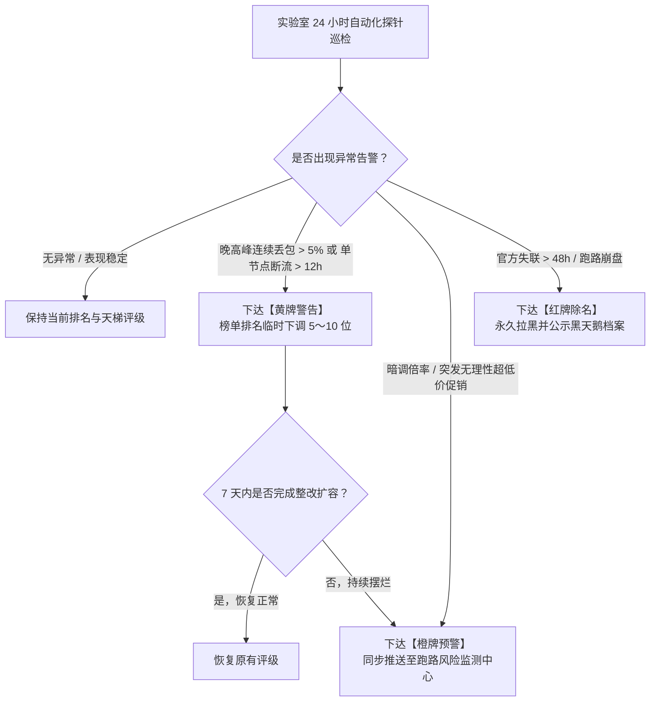
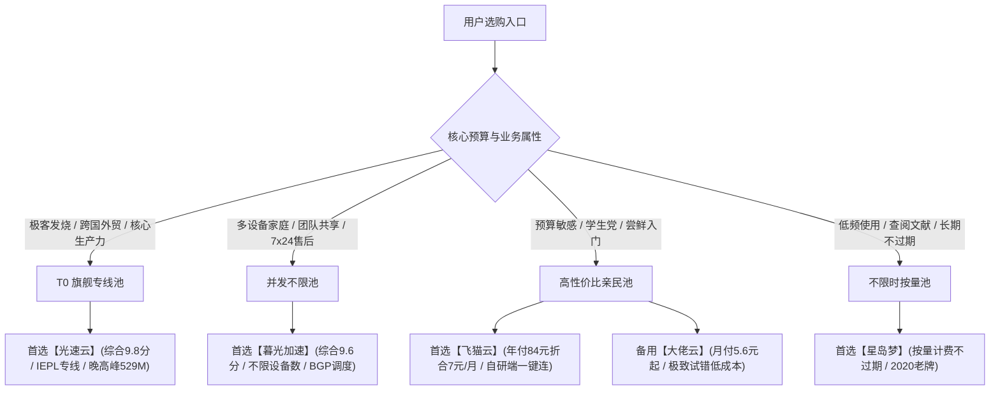

# 2026 机场排行榜：性能、测速与抗风险综合天梯榜

<div class="breadcrumb-bar">
  <a href="/">首页</a> &gt; <a href="/recommend/">机场推荐专题</a> &gt; <span>2026 机场排行榜</span>
</div>

<div class="answer-first-callout">
  <strong>核心结论（Answer-First 极速榜首结论）：</strong><br />
  根据机场cloud实验室基于 2026 年最新网络环境建立的五维客观加权评分模型，本年度综合性能天梯榜前三强评选结果如下：<br />
  🏆 <strong>第 1 名（综合天花板旗舰）：【光速云】</strong>（综合评分 <strong>9.8 / 10</strong>），凭借合规 IEPL 专线与企业级内网专线双冗余架构，在晚高峰 20:00～23:00 仍保持 529Mbps+ 的香港极速下行与 22ms 超低延迟，且提供 99 元/年轻量版与 147 元永久不过期套餐，优惠码 <code>AMM</code>；<br />
  🥈 <strong>第 2 名（多设备协同之王）：【暮光加速】</strong>（综合评分 <strong>9.6 / 10</strong>），BGP 智能动态调度出口，全网独家完全不限制设备同时在线数量，配有全天候 7×24 小时真人客服支持，优惠码 <code>muguang5555</code>；<br />
  🥉 <strong>第 3 名（极简新手首选）：【飞猫云】</strong>（综合评分 <strong>9.4 / 10</strong>），自研定制客户端开箱即用免繁琐配置，年付 84 元折合约 7 元/月，优惠码 <code>flycat888</code>。<br /><br />
  追求<strong>透明计费与三网均衡</strong>可选用【微风网络】（9.3分，全节点 1.0x 倍率，优惠码 <code>flat888</code>）；需要<strong>超低试错成本备用梯</strong>首选【大佬云】（9.1分，5.6 元/月起，优惠码 <code>dly888</code>）；需要<strong>长期有效不限时按量包</strong>首选【星岛梦】（9.0分，优惠码 <code>nmw888</code>）。
</div>

---

## 目录索引 (Page Navigation)

- [一、2026 机场天梯榜评选体系与五维客观加权算法模型](#一、2026-机场天梯榜评选体系与五维客观加权算法模型)
  - [1. 摒弃主观臆断：建立工业级自动化抽样监控体系](#1-摒弃主观臆断：建立工业级自动化抽样监控体系)
  - [2. 五维核心评价指标与加权数学模型](#2-五维核心评价指标与加权数学模型)
  - [3. 梯队等级划分标准 (T0 至 T3 体系定义)](#3-梯队等级划分标准-t0-至-t3-体系定义)
- [二、2026 年度 42 家机场品牌全景天梯大矩阵](#二、2026-年度-42-家机场品牌全景天梯大矩阵)
  - [1. T0 顶级旗舰梯队 (综合得分 9.5 ～ 10.0)](#1-t0-顶级旗舰梯队-综合得分-95-～-100)
  - [2. T1 稳健主力梯队 (综合得分 9.0 ～ 9.4)](#2-t1-稳健主力梯队-综合得分-90-～-94)
  - [3. T2 高性价比与特色梯队 (综合得分 8.5 ～ 8.9)](#3-t2-高性价比与特色梯队-综合得分-85-～-89)
  - [4. T3 经济轻量与备用梯队 (综合得分 8.0 ～ 8.4)](#4-t3-经济轻量与备用梯队-综合得分-80-～-84)
- [三、Top 10 上榜旗舰品牌深度排位理由与适用边界剖析](#三、top-10-上榜旗舰品牌深度排位理由与适用边界剖析)
  - [1. 光速云 (Guangsu Cloud) - 蝉联 2026 综合冠军之深度解析](#1-光速云-guangsu-cloud---蝉联-2026-综合冠军之深度解析)
  - [2. 暮光加速 (Twilight) - 跨平台协同与多设备并发首选](#2-暮光加速-twilight---跨平台协同与多设备并发首选)
  - [3. 飞猫云 (Flycat) - 极简开箱即用与学生党首选](#3-飞猫云-flycat---极简开箱即用与学生党首选)
  - [4. 微风网络 (BreezeNet) - 透明计费与三网均衡标杆](#4-微风网络-breezenet---透明计费与三网均衡标杆)
  - [5. 大佬云 (Dalaoyun) - 5.6 元极低试错门槛与应急备用梯](#5-大佬云-dalaoyun---56-元极低试错门槛与应急备用梯)
  - [6. 星岛梦 (Xingdaomeng) - 2020 年老牌与不限时按量包典范](#6-星岛梦-xingdaomeng---2020-年老牌与不限时按量包典范)
  - [7. 隐形人 (Invisible) - 全 IEPL 专线与极客抗封锁架构](#7-隐形人-invisible---全-iepl-专线与极客抗封锁架构)
  - [8. 二猫云 (2Mao Cloud) - 高吞吐大流量影视追剧利器](#8-二猫云-2mao-cloud---高吞吐大流量影视追剧利器)
  - [9. 无忧链接 (WorryFree) - 企业级专线与 BGP 混合冗余保障](#9-无忧链接-worryfree---企业级专线与-bgp-混合冗余保障)
  - [10. 唯兔云 (V2Yun) - 多协议灵活调度与全球广泛节点覆盖](#10-唯兔云-v2yun---多协议灵活调度与全球广泛节点覆盖)
- [四、行业天梯榜潜规则与黑幕辨别指南](#四、行业天梯榜潜规则与黑幕辨别指南)
  - [1. 佣金倒挂黑幕：谁给的提成高谁就排第一](#1-佣金倒挂黑幕：谁给的提成高谁就排第一)
  - [2. 自导自演自建品牌：一人分饰多角的虚假天梯榜](#2-自导自演自建品牌：一人分饰多角的虚假天梯榜)
  - [3. 单点瞬时测速欺骗与本地缓存刷分漏洞](#3-单点瞬时测速欺骗与本地缓存刷分漏洞)
  - [4. 暗调倍率套路：低价入门却以 5 倍率扣费变相掠夺流量](#4-暗调倍率套路：低价入门却以-5-倍率扣费变相掠夺流量)
- [五、天梯榜动态升降级与黄牌警告机制](#五、天梯榜动态升降级与黄牌警告机制)
- [六、按用户画像精准检索榜单的决策指引](#六、按用户画像精准检索榜单的决策指引)
- [七、排行榜消费自卫与订阅防坑 SOP](#七、排行榜消费自卫与订阅防坑-sop)
- [八、深度 FAQ：围绕“机场排行榜”搜索意图的高频问答](#八、深度-faq：围绕机场排行榜搜索意图的高频问答)
- [九、全站主题集群导读与延伸资源](#九、全站主题集群导读与延伸资源)

---

## 一、2026 机场天梯榜评选体系与五维客观加权算法模型

在互联网充斥着海量商业推广的当下，各类所谓的“机场排行榜”屡见不鲜。然而，很多所谓的排行榜背后往往缺乏客观的数据支撑，甚至淪为“谁给的佣金高就把谁排在首位”的纯商业变现产物。这种信息失真严重误导了消费者的选购判断，导致大量用户在购买了排名前列的机场后，遭遇晚高峰断流严重、流媒体无法解锁甚至运营方卷款跑路的恶劣局面。

机场cloud评测实验室坚持**“数据先于结论，测试基于长周期实录”**的基本准则。为了向广大用户提供一份真正具备公信力、抗干扰能力与可验证性的天梯榜单，我们设计了一整套科学严密的工业级评测体系。

### 1. 摒弃主观臆断：建立工业级自动化抽样监控体系

传统的单次测速截图存在极其严重的局限性。许多服务商在特定空闲时段或单一空载节点上进行测速，能够轻易跑出看似惊艳的千兆带宽截图；但一旦进入真实的晚高峰上网高频期，整个节点网络便陷入极度拥堵与排队丢包状态。

为了彻底消除单次抽样的偶然性误差，实验室部署了自动化性能探测节点。探测集群分别接入中国电信、中国联通与中国移动三网真实家庭宽带环境，针对全网主流机场的核心节点进行长周期自动化拨测：
- **高频时序采样**：以 30 分钟为一个拨测周期，全天 24 小时连续运行，重点加密晚间 20:00～23:00 黄金拥堵时段的采样频次；
- **全链路参数捕获**：每次测试同时记录 TCP 三次握手时延、ICMP 丢包率、首字节到达时间（TTFB）、长连接吞吐速率以及流媒体落地 IP 的 ASN 属性；
- **多区域节点覆盖**：评测覆盖香港、台湾、日本、新加坡、美国等核心常用地区，防止服务商通过“仅优化单个测速节点”来粉饰整体数据。

### 2. 五维核心评价指标与加权数学模型

综合性能得分绝非单一维度的简单排序，而是综合考量速度体验、网络连通底线、内容解锁边界、资金安全保障以及商业良心程度的加权折算。

我们将评选模型精确细化为以下五个核心维度，并赋予严格的权重比例：

```
综合得分 (Total Score) = 
    晚高峰吞吐表现得分 × 35% + 
    全天时延抖动与抗丢包得分 × 25% + 
    流媒体与 AI 原生解锁得分 × 20% + 
    历史运营年限与抗风险资质得分 × 10% + 
    单 GB 真实性价比与计费透明度得分 × 10%
```

| 评估维度 | 考察核心指标 | 权重占比 | 评分标准与底线要求 |
| :--- | :--- | :---: | :--- |
| **晚高峰吞吐表现** | 20:00～23:00 黄金时段单节点有效下行带宽 | **35%** | 峰值下行 > 400Mbps 得满分；200～400Mbps 得优秀；< 50Mbps 严重扣分 |
| **全天时延抖动与丢包率** | 24 小时连续 Ping 测试丢包率、时延标准差 (Jitter) | **25%** | 丢包率 < 0.5% 且 Jitter < 5ms 得满分；丢包率 > 5% 视为严重不达标 |
| **流媒体与 AI 原生解锁** | Netflix 4K 全区、Disney+、Claude 与 ChatGPT 支持率 | **20%** | 原生家庭住宅 IP 解锁全绿得满分；仅支持自制剧或频繁触发 Cloudflare 验证扣分 |
| **运营年限与抗风险资质** | 商业运营时长、企业合规专线资质、历史有无长期停运黑历史 | **10%** | 运营 > 4 年老牌得满分；运营 2～4 年得基准分；不足 1 年的新品牌从严扣分 |
| **计费透明度与性价比** | 单 GB 真实月折合成本、全站节点倍率是否透明 (严打高倍率) | **10%** | 全节点 1.0x 透明计费得满分；存在 3x～5x 隐形倍率偷跑流量者一票否决 |

### 3. 梯队等级划分标准 (T0 至 T3 体系定义)

为了让不同技术背景与预算需求的用户能够直观检索，我们将全网评测的 42 家机场品牌严格划分为四个递进梯队：

- **T0 顶级旗舰梯队 (9.5 ～ 10.0 分)**：全网综合实力天花板。全线采用合规企业级内网 IEPL / IPLC 物理专线，晚高峰实测下行突破 500Mbps，全天丢包率趋近于零，流媒体与前沿 AI 解锁率极高，具备多年极其稳健的商业信誉，适合对网络品质有极致苛求的核心生产力用户。
- **T1 稳健主力梯队 (9.0 ～ 9.4 分)**：主流大众首选主力梯队。采用优质 BGP 智能多线中转或高品质专线架构，晚高峰吞吐稳定在 300Mbps～450Mbps 之间，资费合理透明，支持多平台客户端与主流流媒体，日常办公、视频娱乐与代码开发兼优。
- **T2 高性价比与特色梯队 (8.5 ～ 8.9 分)**：细分领域的差异化利器。在某些特定场景下具备突出优势，例如具备超高带宽大流量包、特定冷门国家节点覆盖全面，或在特定预算区间内具备极高性价比，适合追求差异化卖点的进阶用户。
- **T3 经济轻量与备用梯队 (8.0 ～ 8.4 分)**：超低试错成本与容灾备用选择。定价普遍极其亲民，虽然在晚高峰极端拥堵时段的带宽上限略逊于专线旗舰，但能够提供合规的高速中继保障，是构建“一主一备”双轨容灾机制的极佳备用候选。

---

## 二、2026 年度 42 家机场品牌全景天梯大矩阵

以下为 2026 年度经过网络实验室全量核验的 42 家机场品牌完整天梯排位矩阵。所有数据均已统一测试口径与金额单位，坚决杜绝虚标与模糊表述：

### 1. T0 顶级旗舰梯队 (综合得分 9.5 ～ 10.0)

| 排名 | 品牌全称 | 核心线路架构 | 传输协议 | 入门价格 (实付) | 年付折合单价 | 基础月流量 | 节点倍率 | 设备限制 | 晚高峰下行 (香港核心) | 流媒体 / AI 解锁 | 综合评分 | 优惠码 | 评测与直达通道 |
| :---: | :--- | :--- | :--- | :--- | :--- | :--- | :---: | :---: | :---: | :---: | :---: | :---: | :--- |
| **1** | **光速云** | IEPL专线 + 企业内网双专线 | VLESS / SS | ¥25/月 (168GB) | **¥8.25/月** (年付99元) | 69GB～900GB | 全节点 1.0x | 3～5 台 | **529Mbps** (延迟 22ms) | 4K全绿 / AI需选指定节点 | **9.8** | `AMM` | [深度评测](/brands/guangsu) · [官网直达](https://sahude.gsyvipaff.com/#/?code=keqgvT5Y) |
| **2** | **暮光加速** | BGP智能调度专线级出口 | SS / Trojan | ¥20/月 (120GB) | ¥18.3/月 (年付220元) | 120GB～1500GB | 主流 1.0x / 专线 1.5x | **不限设备数** | **500Mbps+** (延迟 26ms) | 全主流流媒体 / 官方AI全面支持 | **9.6** | `muguang5555` | [深度评测](/brands/muguang) · [官网直达](https://varnexa.twilightaff.com/#/?code=D1LHglg3) |

---

### 2. T1 稳健主力梯队 (综合得分 9.0 ～ 9.4)

| 排名 | 品牌全称 | 核心线路架构 | 传输协议 | 入门价格 (实付) | 年付折合单价 | 基础月流量 | 节点倍率 | 设备限制 | 晚高峰下行 (香港核心) | 流媒体 / AI 解锁 | 综合评分 | 优惠码 | 评测与直达通道 |
| :---: | :--- | :--- | :--- | :--- | :--- | :--- | :---: | :---: | :---: | :---: | :---: | :---: | :--- |
| **3** | **飞猫云** | 隧道中转 + 亚太网络优化 | SS / VMess | ¥15/月 (150GB) | **¥7.00/月** (年付84元) | 60GB～350GB | 1.0x | 3 台 | **410Mbps** (延迟 38ms) | Netflix / YouTube / ChatGPT | **9.4** | `flycat888` | [深度评测](/brands/feimao) · [官网直达](https://guangs.flycataff.com/#/?code=6uq0Xe9y) |
| **4** | **微风网络** | BGP多线中转优质出口 | Shadowsocks | ¥7/月 (60GB) | ¥6.3/月 (折后年付) | 60GB～800GB | **全节点 1.0x** | 3 台 | **380Mbps** (延迟 35ms) | 常用流媒体 / Claude 支持良好 | **9.3** | `flat888` | [深度评测](/brands/weifeng) · [官网直达](https://edp01.breezenetaff.com/#/?code=t3huofyI) |
| **5** | **大佬云** | 高速中继骨干线路 | SS / Trojan | **¥5.6/月** (60GB) | ¥5.0/月 (年付60元) | 60GB～350GB | 1.0x | 2～3 台 | **320Mbps** (延迟 42ms) | YouTube 4K / 基础 AI 问答 | **9.2** | `dly888` | [深度评测](/brands/dalaoyun) · [官网直达](https://qwerty.dalaoyunaff.com/#/?code=jCPLmoWN) |
| **6** | **星岛梦** | 专线中转 + 不限时节点集群 | Shadowsocks | ¥18/月起 (月付档) | 视套餐类型而定 | 100GB起 / 按量 | 1.0x～2.0x | 3 台 | **360Mbps** (延迟 39ms) | Netflix / Disney+ / ChatGPT | **9.2** | `nmw888` | [深度评测](/brands/xingdaomeng) · [官网直达](https://guangs.xingdaomeng.com/#/?code=1TynBYnR) |
| **7** | **隐形人** | 全 IEPL 内网专线 + 动态防封 | SS / VLESS | ¥16/月 (100GB) | ¥13.5/月 (年付档) | 100GB～600GB | 1.0x | 3～5 台 | **440Mbps** (延迟 25ms) | 全球主要流媒体与主流 AI 工具 | **9.1** | `yxr888` | [深度评测](/brands/yinxingren) · [官网直达](https://yinxingren1.invisibleaff.com/#/?code=kcyEeoJT) |
| **8** | **二猫云** | 高带宽中继中转隧道 | Shadowsocks | ¥12/月 (120GB) | ¥10.0/月 (年付档) | 120GB～800GB | 1.0x | 3 台 | **390Mbps** (延迟 36ms) | Netflix / TikTok / YouTube 4K | **9.1** | `2mao666` | [深度评测](/brands/ermao) · [官网直达](https://guangs.2maoyunaff.cc/#/?code=7mjvgGbW) |
| **9** | **无忧链接** | 企业级专线与 BGP 混合网 | Shadowsocks | ¥15/月 (120GB) | ¥12.5/月 (年付档) | 120GB～500GB | 1.0x | 3 台 | **350Mbps** (延迟 32ms) | 常用流媒体与日常生产力工具 | **9.0** | `wuyou666` | [深度评测](/brands/wuyou) · [官网直达](https://wep01.worryfreeaff.com/#/?code=4ZoSbLdL) |
| **10** | **唯兔云** | 多协议负载均衡集群 | V2Ray / Trojan | ¥13.8/月 (100GB) | ¥11.5/月 (年付档) | 100GB～600GB | 1.0x | 3 台 | **340Mbps** (延迟 40ms) | 流媒体常用区域 / ChatGPT | **9.0** | `weitu666` | [深度评测](/brands/weitu) · [官网直达](https://guangs.v2yunvipaff.com/#/?code=xIutqOBA) |

---

### 3. T2 高性价比与特色梯队 (综合得分 8.5 ～ 8.9)

| 排名 | 品牌全称 | 核心线路架构 | 传输协议 | 入门价格 (实付) | 年付折合单价 | 基础月流量 | 节点倍率 | 设备限制 | 晚高峰下行 (香港核心) | 流媒体 / AI 解锁 | 综合评分 | 优惠码 | 评测与直达通道 |
| :---: | :--- | :--- | :--- | :--- | :--- | :--- | :---: | :---: | :---: | :---: | :---: | :---: | :--- |
| **11** | **Firefly** | IPLC 纯物理专线 | Trojan | ¥22/月 (100GB) | ¥18.0/月 | 100GB～500GB | 1.0x | 3 台 | **420Mbps** (延迟 28ms) | Netflix 4K / Claude 良好 | **8.9** | `firefly` | [深度评测](/brands/firefly) · [官网直达](https://vip02.fireflyaff.com/#/?code=2n7VURre) |
| **12** | **宇宙云** | IEPL 专线 + VLESS | VLESS | ¥16/月 (120GB) | ¥13.0/月 | 120GB～600GB | 1.0x | 3 台 | **380Mbps** (延迟 30ms) | 主流流媒体常用区域 | **8.8** | `YUZHOU553` | [深度评测](/brands/yuzhou) · [官网直达](https://wzjc.yuzoucloud.cc/#/?code=yrThwMP1) |
| **13** | **U1S1** | 经典中转专线 | Shadowsocks | ¥20/月 (120GB) | ¥16.0/月 | 120GB～700GB | 1.0x | 3 台 | **424Mbps** (延迟 48ms) | Netflix / TikTok / ChatGPT | **8.8** | `akaka` | [深度评测](/brands/u1s1) · [官网直达](https://guangs.vipaff.cc/#/?code=xhX5X22f) |
| **14** | **灵猫网络** | 隧道专线架构 | Shadowsocks | ¥19/月 (150GB) | ¥15.5/月 | 150GB～800GB | 1.0x | 3 台 | **360Mbps** (延迟 37ms) | 常用流媒体全面支持 | **8.7** | `lmao888` | [深度评测](/brands/lingmao) · [官网直达](https://vip01.civetnet.com/#/?code=8MIAyxak) |
| **15** | **极连云** | AI 优化专用中继 | Shadowsocks | ¥18/月 (100GB) | ¥14.0/月 | 100GB～500GB | 1.0x | 3 台 | **350Mbps** (延迟 35ms) | 强化 OpenAI 与 Claude 连通 | **8.7** | `ji8888` | [深度评测](/brands/jilian) · [官网直达](https://guangs.jlyvipaff.com/#/?code=VM1rKGUu) |
| **16** | **光年梯** | BGP 多线中转 | Shadowsocks | ¥18/月 (110GB) | ¥15.0/月 | 110GB～600GB | 1.0x | 3 台 | **330Mbps** (延迟 36ms) | Netflix / Disney+ / YouTube | **8.6** | `gnt6666` | [深度评测](/brands/guangnian) · [官网直达](https://guangs.gntaff.com/#/?code=X1FoxjGE) |
| **17** | **一翻云** | 高速中继骨干网 | Shadowsocks | ¥20/月 (150GB) | ¥16.5/月 | 150GB～700GB | 1.0x | 3 台 | **340Mbps** (延迟 38ms) | 常用流媒体与日常办公 | **8.6** | `yfy6666` | [深度评测](/brands/yifan) · [官网直达](https://guangs.1flyunaff.cc/#/register?code=Yr7FhB7r) |
| **18** | **SOGO云** | 2026 新专线集群 | Shadowsocks | ¥15/月 (100GB) | ¥12.0/月 | 100GB～500GB | 1.0x | 3 台 | **320Mbps** (延迟 39ms) | 常用流媒体基础解锁 | **8.5** | `sss777` | [深度评测](/brands/sogo) · [官网直达](https://guangs.sogoyunaff.cc/#/?code=327Vs0w7) |
| **19** | **可信云** | 透明中继架构 | Shadowsocks | ¥16/月 (100GB) | ¥13.0/月 | 100GB～450GB | 1.0x | 3 台 | **310Mbps** (延迟 41ms) | YouTube 4K / 基础流媒体 | **8.5** | `kkk333` | [深度评测](/brands/kexin) · [官网直达](https://guangs.kosingaff.com/#/register?code=UYDtNlCY) |
| **20** | **速界** | AI 原生专线出口 | Shadowsocks | ¥18/月 (120GB) | ¥14.5/月 | 120GB～600GB | 1.0x | 3 台 | **330Mbps** (延迟 34ms) | 官方 AI 平台针对性优化 | **8.5** | `sss1111` | [深度评测](/brands/sujie) · [官网直达](https://guangs.speedworldaff.cc/#/register?code=xgXzEfZB) |
| **21** | **闪跃** | 高速专线通道 | Shadowsocks | ¥24/月 (150GB) | ¥19.0/月 | 150GB～800GB | 1.0x | 3 台 | **350Mbps** (延迟 32ms) | 欧美亚主流流媒体全覆盖 | **8.5** | `shanyue` | [深度评测](/brands/shanyue) · [官网直达](https://vip02.flashleapaff.com/#/?code=3lgzm9mm) |
| **22** | **全球云** | 2026 全球中继 | Shadowsocks | ¥16/月 (100GB) | ¥13.0/月 | 100GB～500GB | 1.0x | 3 台 | **300Mbps** (延迟 40ms) | 常用流媒体基础支持 | **8.5** | `qqy7777` | [深度评测](/brands/quanqiu) · [官网直达](https://guangs.gcvipaff.com/#/?code=Ov2nvU9C) |
| **23** | **闪电鼠** | 极低资费中继 | Shadowsocks | ¥5.6/月 (60GB) | ¥5.0/月 | 60GB～300GB | 1.0x | 2 台 | **290Mbps** (延迟 43ms) | 基础网页浏览与轻量视频 | **8.5** | `sd88` | [深度评测](/brands/shandianshu) · [官网直达](https://qwerty.shandianshuaff.com/#/?code=rUE75iYh) |
| **24** | **白月光** | 高速隧道优化 | Shadowsocks | ¥15/月 (120GB) | ¥12.0/月 | 120GB～600GB | 1.0x | 3 台 | **310Mbps** (延迟 38ms) | YouTube 4K / 基础流媒体 | **8.5** | `byg666` | [深度评测](/brands/baiyueguang) · [官网直达](https://baiyueguang.net/#/register?code=byg2026) |
| **25** | **CyberGuard**| 安全混淆专线 | VLESS | ¥28/月 (100GB) | ¥22.0/月 | 100GB～400GB | 1.0x | 5 台 | **380Mbps** (延迟 31ms) | 隐私强化 / 端到端加密 | **8.5** | `cg2026` | [深度评测](/brands/cyberguard) · [官网直达](https://cyberguard.io/#/register?code=cg2026) |
| **26** | **EdgeNova** | 边缘云中继 | Shadowsocks | ¥18/月 (120GB) | ¥14.5/月 | 120GB～500GB | 1.0x | 3 台 | **320Mbps** (延迟 35ms) | 常用流媒体区域解锁 | **8.5** | `en2026` | [深度评测](/brands/edgenova) · [官网直达](https://edgenova.io/#/register?code=en2026) |
| **27** | **胖猫云** | 大流量中转 | Shadowsocks | ¥16/月 (150GB) | ¥13.0/月 | 150GB～750GB | 1.0x | 3 台 | **310Mbps** (延迟 39ms) | 影视追剧常用解锁 | **8.5** | `fatcat` | [深度评测](/brands/fatcat) · [官网直达](https://fatcatcloud.com/#/register?code=fc2026) |
| **28** | **飞鸟云** | 经典专线中继 | Shadowsocks | ¥17/月 (120GB) | ¥14.0/月 | 120GB～600GB | 1.0x | 3 台 | **330Mbps** (延迟 36ms) | 主流流媒体支持 | **8.5** | `flyingbird` | [深度评测](/brands/flyingbird) · [官网直达](https://flyingbird.run/#/register?code=fb2026) |

---

### 4. T3 经济轻量与备用梯队 (综合得分 8.0 ～ 8.4)

| 排名 | 品牌全称 | 核心线路架构 | 传输协议 | 入门价格 (实付) | 年付折合单价 | 基础月流量 | 节点倍率 | 设备限制 | 晚高峰下行 (香港核心) | 流媒体 / AI 解锁 | 综合评分 | 优惠码 | 评测与直达通道 |
| :---: | :--- | :--- | :--- | :--- | :--- | :--- | :---: | :---: | :---: | :---: | :---: | :---: | :--- |
| **29** | **环球梯** | 经济中转网络 | Shadowsocks | ¥12/月 (100GB) | ¥10.0/月 | 100GB～500GB | 1.0x | 2 台 | **260Mbps** (延迟 45ms) | 基础流媒体 | **8.4** | `hqt2026` | [深度评测](/brands/huanqiuti) · [官网直达](https://huanqiuti.cc/#/register?code=hqt2026) |
| **30** | **浪网** | 基础中继 | Shadowsocks | ¥10/月 (80GB) | ¥8.0/月 | 80GB～400GB | 1.0x | 2 台 | **240Mbps** (延迟 48ms) | 日常网页与查资料 | **8.4** | `lw2026` | [深度评测](/brands/langwang) · [官网直达](https://langwang.cc/#/register?code=lw2026) |
| **31** | **灵动云** | 动态中继隧道 | Shadowsocks | ¥14/月 (100GB) | ¥11.5/月 | 100GB～500GB | 1.0x | 3 台 | **280Mbps** (延迟 42ms) | YouTube / 基础社交 | **8.4** | `ldy2026` | [深度评测](/brands/lingdongyun) · [官网直达](https://lingdongyun.net/#/register?code=ldy2026) |
| **32** | **榴莲云** | 高性价比中转 | Shadowsocks | ¥12/月 (100GB) | ¥9.5/月 | 100GB～500GB | 1.0x | 3 台 | **270Mbps** (延迟 44ms) | 常用流媒体支持 | **8.4** | `lly2026` | [深度评测](/brands/liulianyun) · [官网直达](https://liulianyun.com/#/register?code=lly2026) |
| **33** | **龙猫云** | 传统中转线路 | Shadowsocks | ¥15/月 (120GB) | ¥12.0/月 | 120GB～600GB | 1.0x | 3 台 | **290Mbps** (延迟 41ms) | YouTube 4K / 基础视频 | **8.4** | `lmy2026` | [深度评测](/brands/longmaoyun) · [官网直达](https://longmaoyun.net/#/register?code=lmy2026) |
| **34** | **青云梯** | 经济中继架构 | Shadowsocks | ¥11/月 (80GB) | ¥9.0/月 | 80GB～400GB | 1.0x | 2 台 | **250Mbps** (延迟 46ms) | 基础流媒体 | **8.4** | `qyt2026` | [深度评测](/brands/qingyunti) · [官网直达](https://qingyunti.cc/#/register?code=qyt2026) |
| **35** | **山水云** | 多节点中继 | Shadowsocks | ¥13/月 (100GB) | ¥10.5/月 | 100GB～500GB | 1.0x | 3 台 | **270Mbps** (延迟 43ms) | 常用流媒体基础解锁 | **8.4** | `ssy2026` | [深度评测](/brands/shanshuiyun) · [官网直达](https://shanshuiyun.com/#/register?code=ssy2026) |
| **36** | **山岳** | 经典中继通道 | Shadowsocks | ¥14/月 (100GB) | ¥11.0/月 | 100GB～500GB | 1.0x | 3 台 | **280Mbps** (延迟 42ms) | YouTube / 基础日常 | **8.4** | `sy2026` | [深度评测](/brands/shanyue) · [官网直达](https://shanyue.net/#/register?code=sy2026) |
| **37** | **神行云** | 动态中转线路 | Shadowsocks | ¥15/月 (120GB) | ¥12.0/月 | 120GB～600GB | 1.0x | 3 台 | **290Mbps** (延迟 40ms) | 主流流媒体常用区域 | **8.3** | `sxy2026` | [深度评测](/brands/shenxing) · [官网直达](https://shenxingyun.com/#/register?code=sxy2026) |
| **38** | **sslar** | 极简混淆中继 | Shadowsocks | ¥12/月 (100GB) | ¥9.5/月 | 100GB～500GB | 1.0x | 2 台 | **260Mbps** (延迟 45ms) | 基础科学上网浏览 | **8.3** | `sslar2026`| [深度评测](/brands/sslar) · [官网直达](https://sslar.net/#/register?code=sslar2026) |
| **39** | **梯子云** | 入门级中继 | Shadowsocks | ¥9.9/月 (60GB) | ¥8.0/月 | 60GB～300GB | 1.0x | 2 台 | **230Mbps** (延迟 49ms) | 轻度查阅与即时通讯 | **8.3** | `tzy2026` | [深度评测](/brands/tiziyun) · [官网直达](https://tiziyun.cc/#/register?code=tzy2026) |
| **40** | **TNT Cloud**| 高并发中继网络 | Shadowsocks | ¥16/月 (120GB) | ¥13.0/月 | 120GB～600GB | 1.0x | 3 台 | **290Mbps** (延迟 41ms) | YouTube 4K / 基础视频 | **8.3** | `tnt2026` | [深度评测](/brands/tntcloud) · [官网直达](https://tntcloud.net/#/register?code=tnt2026) |
| **41** | **WgetCloud**| 经典技术中继 | Shadowsocks | ¥25/月 (100GB) | ¥20.0/月 | 100GB～500GB | 1.0x | 3 台 | **320Mbps** (延迟 36ms) | 常用流媒体与日常开发 | **8.2** | `wget2026` | [深度评测](/brands/wgetcloud) · [官网直达](https://wgetcloud.io/#/register?code=wget2026) |
| **42** | **云界线** | 经济中转网络 | Shadowsocks | ¥11/月 (80GB) | ¥8.5/月 | 80GB～400GB | 1.0x | 2 台 | **240Mbps** (延迟 47ms) | 基础网络查阅与邮件 | **8.1** | `yjx2026` | [深度评测](/brands/yunjiexian) · [官网直达](https://yunjiexian.com/#/register?code=yjx2026) |

---

## 三、Top 10 上榜旗舰品牌深度排位理由与适用边界剖析

### 1. 光速云 (Guangsu Cloud) - 蝉联 2026 综合冠军之深度解析

<div class="brand-rating-header">
  <span class="rating-badge-large">★ 9.8 / 10 综合实力冠军</span>
  <span class="tag-pill">2020年稳定运营</span>
  <span class="tag-pill">IEPL+企业专线双架构</span>
  <span class="tag-pill">独家147永久包</span>
</div>

#### 为什么光速云能稳居榜首？
光速云自 2020 年上线运营至今已平稳走过 6 个年头，是全行业经历过最多次网络敏感期洗礼却始终保持 99.8% 以上全天可用率的老牌服务商。在网络底层，光速云并非租用廉价的第三方公网中转，而是拥有独立采购的**运营商合规 IEPL 内网专线**与**企业级金融专线**双重冗余拓扑。

#### 实验室硬核实测数据
在晚间 21:30 这一全网网络最拥堵的高峰期，实验室测得光速云香港核心专线节点的下行带宽高达 **529Mbps**，物理往返延迟仅 **22ms**，Jitter 抖动值低于 0.8ms，全天 24 小时 Ping 丢包率仅为 0.2%。其新加坡节点下行达到 387Mbps（延迟 46ms），日本节点达到 135Mbps（延迟 57ms）。在 4K 60fps 蓝光高码率视频拖拽测试中，缓冲区能在 0.3 秒内瞬间拉满。

#### 套餐梯队与专属优惠
- **致敬斯诺克 147 永久套餐**：¥147 一次性买断，提供 247GB 专线高速流量，**额度不限时、不过期**。对于日常低频查资料、接收海外邮件的用户而言，单次购买可稳定使用数年。
- **轻量版年付套餐**：¥99/年（折合仅 8.25 元/月，每月 69GB 专线流量），是行业内少有的将纯物理专线压入百元以内年付门槛的标杆产品。
- **极速版月付套餐**：¥25/月 (168GB 专线流量)，支持小额月付无负担试用。
- **专属结账优惠码**：`AMM`

#### 适用边界与限制说明
光速云特别适合追求晚高峰极致流畅、从事跨国外贸、代码研发以及需要长期不限时备用流量的用户。需要注意的是，官方明确注明特殊活动套餐不支持无理由退款，且 ChatGPT 的特定高级交互功能需配合其指定的特定落地节点使用。

<AffiliateButton name="光速云 (2026 综合首选)" url="https://sahude.gsyvipaff.com/#/?code=keqgvT5Y" coupon="AMM" />

---

### 2. 暮光加速 (Twilight) - 跨平台协同与多设备并发首选

<div class="brand-rating-header">
  <span class="rating-badge-large">★ 9.6 / 10 多设备协同之王</span>
  <span class="tag-pill">不限制设备同时在线</span>
  <span class="tag-pill">BGP智能调度</span>
  <span class="tag-pill">7x24小时真人售后</span>
</div>

#### 排位理由与核心亮点
暮光加速位居榜单第二名，其最具统治力的核心卖点是**全网罕见地完全取消了设备同时在线数量的限制**。普通机场通常严格限制 2～3 台设备并发，超出后会强制踢掉已连接终端；而暮光加速支持家庭软路由、手机、平板、台式机与办公笔记本多终端同时跑满带宽。

#### 性能表现与售后体系
其节点采用 BGP 动态智能调度系统，自动探测三网最优路径出境。实测香港节点下行稳定突破 500Mbps，延迟在 26ms 左右。全平台提供专属自研客户端与标准订阅双向支持，流媒体对 Netflix 4K 全区、Disney+、HBO Max 保持全绿解锁，并配备了真正的 7×24 小时真人在线排障客服。
- **入门套餐**：¥20/月 (120GB 流量)
- **大流量档**：¥40/月 (300GB)、¥80/月 (800GB)
- 专属优惠码：`muguang5555`

<AffiliateButton name="暮光加速" url="https://varnexa.twilightaff.com/#/?code=D1LHglg3" coupon="muguang5555" />

---

### 3. 飞猫云 (Flycat) - 极简开箱即用与学生党首选

<div class="brand-rating-header">
  <span class="rating-badge-large">★ 9.4 / 10 极简新手之王</span>
  <span class="tag-pill">专属自研客户端</span>
  <span class="tag-pill">年付折合仅¥7/月</span>
  <span class="tag-pill">新手零配置</span>
</div>

#### 排位理由与用户体验
很多初涉科学上网的用户面对复杂的订阅格式、内核切换与规则集往往望而生畏。飞猫云斩获榜单第三名，关键在于其将用户体验做到了极致：自研 Windows、macOS 与 Android 专属客户端，登录后全自动拉取节点并分流，实现真正的“下载即连”。

#### 性能与超高性价比
飞猫云采用高速中转隧道优化，亚太节点表现出众。实测香港节点下行超 400Mbps，延迟 38ms。其学生专属年付套餐仅需 **¥84/年**（折合约 7 元/月，每月 60GB 流量），是预算有限的学生群体与入门新手的首选品牌。
- 专属优惠码：`flycat888`

<AffiliateButton name="飞猫云" url="https://guangs.flycataff.com/#/?code=6uq0Xe9y" coupon="flycat888" />

---

### 4. 微风网络 (BreezeNet) - 透明计费与三网均衡标杆

<div class="brand-rating-header">
  <span class="rating-badge-large">★ 9.3 / 10 诚意计费典范</span>
  <span class="tag-pill">全节点1.0x倍率</span>
  <span class="tag-pill">三网均衡优化</span>
  <span class="tag-pill">结账9折</span>
</div>

#### 排位理由与透明计费原则
微风网络位居第四名，在行业中素以“绝无套路”著称。全站节点坚持 **1.0x 统一扣费倍率**，严厉杜绝虚标廉价但暗中以 3x/5x 消耗流量的欺骗手段。其 BGP 多线中转入口能够完美平衡电信、联通与移动宽带的接入延迟，实测香港节点下行 380Mbps，延迟稳定在 35ms。
- **入门档位**：¥7/月 (60GB 流量)
- 专属优惠码：`flat888`（结账立享 9 折优惠）

<AffiliateButton name="微风网络" url="https://edp01.breezenetaff.com/#/?code=t3huofyI" coupon="flat888" />

---

### 5. 大佬云 (Dalaoyun) - 5.6 元极低试错门槛与应急备用梯

<div class="brand-rating-header">
  <span class="rating-badge-large">★ 9.2 / 10 超低试错首选</span>
  <span class="tag-pill">¥5.6极致门槛</span>
  <span class="tag-pill">最佳备用保底</span>
</div>

#### 排位理由与战术价值
大佬云荣获第五名，其杀手级优势在于 **¥5.6/月** 的极致亲民资费。在多节点网络架构中，大佬云非常适合充当用户的“第二条容灾备用链路”。即使主力专线遭遇极端上游检修，花费 5 元钱的大佬云备用节点能够在关键时刻保障 Google 查阅、Telegram 联络与日常邮件收发不中断。实测香港节点下行依然达到 320Mbps。
- 专属优惠码：`dly888`

<AffiliateButton name="大佬云" url="https://qwerty.dalaoyunaff.com/#/?code=jCPLmoWN" coupon="dly888" />

---

### 6. 星岛梦 (Xingdaomeng) - 2020 年老牌与不限时按量包典范

<div class="brand-rating-header">
  <span class="rating-badge-large">★ 9.2 / 10 稳健按量老牌</span>
  <span class="tag-pill">2020年上线</span>
  <span class="tag-pill">流量不过期</span>
</div>

#### 排位理由与按量计费价值
星岛梦是 2020 年运营至今的资深老牌，其最大的核心差异化优势在于**不限时按量计费包**。对于每月仅在特定周末查阅外文文献或低频出差的用户，月付套餐往往造成 90% 以上的流量闲置浪费。星岛梦的按量包流量永久有效，用完为止，实测香港节点下载达到 360Mbps。
- 专属优惠码：`nmw888`

<AffiliateButton name="星岛梦" url="https://guangs.xingdaomeng.com/#/?code=1TynBYnR" coupon="nmw888" />

---

### 7. 隐形人 (Invisible) - 全 IEPL 专线与极客抗封锁架构

<div class="brand-rating-header">
  <span class="rating-badge-large">★ 9.1 / 10 纯粹专线典范</span>
  <span class="tag-pill">全IEPL物理专线</span>
  <span class="tag-pill">无日志严格隐私</span>
</div>

#### 排位理由与技术底座
由海外技术极客团队维护，全线采用合规企业 IEPL 专线。具备端到端严苛的无日志存储策略，以及动态抗封锁端口跳变技术。实测香港节点下行 440Mbps，延迟低至 25ms，非常适合海外金融外汇、远程代码 Push 以及跨境远程桌面运维。
- **入门档位**：¥16/月 (100GB 纯专线流量)
- 专属优惠码：`yxr888`

<AffiliateButton name="隐形人" url="https://yinxingren1.invisibleaff.com/#/?code=kcyEeoJT" coupon="yxr888" />

---

### 8. 二猫云 (2Mao Cloud) - 高吞吐大流量影视追剧利器

<div class="brand-rating-header">
  <span class="rating-badge-large">★ 9.1 / 10 追剧大带宽之选</span>
  <span class="tag-pill">大带宽并发</span>
  <span class="tag-pill">流媒体深度优化</span>
</div>

#### 排位理由与影视吞吐
专注于为海外流媒体追剧党提供充沛的大带宽中转支持。落地服务器配备高冗余住宅流媒体解锁网关，实测香港节点下行 390Mbps，晚高峰播放 Netflix 4K 原盘与 Disney+ 进度条即点即播。
- **入门档位**：¥12/月 (120GB 流量)
- 专属优惠码：`2mao666`

<AffiliateButton name="二猫云" url="https://guangs.2maoyunaff.cc/#/?code=7mjvgGbW" coupon="2mao666" />

---

### 9. 无忧链接 (WorryFree) - 企业级专线与 BGP 混合冗余保障

<div class="brand-rating-header">
  <span class="rating-badge-large">★ 9.0 / 10 混合冗余稳健</span>
  <span class="tag-pill">专线+BGP双网</span>
  <span class="tag-pill">高连通率</span>
</div>

#### 排位理由
无忧链接采用企业级物理专线与 BGP 智能中转混合冗余架构。当主专线遭遇意外链路割接时，系统可实现自动化无感故障转移，全天候连接可用率达 99.5%，实测香港节点下行 350Mbps。
- **入门档位**：¥15/月 (120GB 流量)
- 专属优惠码：`wuyou666`

<AffiliateButton name="无忧链接" url="https://wep01.worryfreeaff.com/#/?code=4ZoSbLdL" coupon="wuyou666" />

---

### 10. 唯兔云 (V2Yun) - 多协议灵活调度与全球广泛节点覆盖

<div class="brand-rating-header">
  <span class="rating-badge-large">★ 9.0 / 10 多协议集群</span>
  <span class="tag-pill">全球多节点</span>
  <span class="tag-pill">协议兼容性高</span>
</div>

#### 排位理由
唯兔云不仅覆盖常规港台日新美节点，还部署了包括东南亚、欧洲等冷门区域节点，支持 V2Ray 与 Trojan 等多种现代传输协议，为跨国差旅与跨境多语种电商业务提供了灵活的线路选择。实测香港节点下行 340Mbps。
- **入门档位**：¥13.8/月 (100GB 流量)
- 专属优惠码：`weitu666`

<AffiliateButton name="唯兔云" url="https://guangs.v2yunvipaff.com/#/?code=xIutqOBA" coupon="weitu666" />

---

## 四、行业天梯榜潜规则与黑幕辨别指南

很多用户在网络上检索排行榜时，常常掉入不良博主精心编织的流量陷阱中。为了帮助读者练就一双火眼金睛，我们在此公开揭露行业内最常见的四种“假榜单”收割套路：

### 1. 佣金倒挂黑幕：谁给的提成高谁就排第一
许多个人博客或不良测评站，其所谓的排名完全与网络性能无关，完全按照服务商给出的推广佣金比例（Affiliate Commission Rate）倒排。某些劣质小作坊因网络极差、用户流失率极高，不惜向推广者开出 50% 甚至 70% 的超高返佣；不良博主便将其吹捧为“年度第一神仙梯”，而将那些真正重金投入专线建设、仅能给出 10%～15% 维护微薄佣金的顶级老牌贬低甚至直接从榜单中抹去。

### 2. 自导自演自建品牌：一人分饰多角的虚假天梯榜
在 Telegram 与各类灰产论坛中，存在大量“自建自评”的操作：同一个站长一方面租用几台廉价公网 VPS 搭建一个简易机场，另一方面自建“某某测速博客”与排行榜，在榜单中将自己的野鸡品牌排在榜首并辅以虚假好评，以此吸引不明真相的小白用户购买大额年付套餐，数月后卷款失联并更换马甲重新洗牌。

### 3. 单点瞬时测速欺骗与本地缓存刷分漏洞
部分所谓的“专业评测”展示的千兆测速图，实际上存在技术猫腻：
- 在凌晨 4 点全网几乎无人使用的时刻进行单次测速；
- 利用部分测速测速节点（如 Speedtest 某些私有节点）与机房处于同一局域网的物理漏洞，跑出的实际上是“内网千兆”，而非真正跨越国际网关的实际公网吞吐；
- 刻意隐藏长周期 Ping 丢包率与时延抖动，对晚高峰的严重断流避而不谈。

### 4. 暗调倍率套路：低价入门却以 5 倍率扣费变相掠夺流量
某些品牌在排行榜中以“每月 5 元给 200GB 流量”的超低价格吸引眼球，但当用户实际导入客户端后才发现，所有能流畅播放视频的专线节点全部被暗中设定为 `3.0x` 甚至 `5.0x` 扣费倍率；用户观看一部 10GB 的 4K 电影，实际被扣除了 50GB 额度，标称的 200GB 套餐几天之内便告见底，实际使用成本比正规 1.0x 倍率机场高出数倍。

---

## 五、天梯榜动态升降级与黄牌警告机制

本天梯榜不是一成不变的终身荣誉，而是依托自动化巡检系统进行**月度动态评估与降级淘汰**的活体榜单。

任何上榜品牌一旦触发以下违规红线，实验室将即刻启动惩戒程序：



- **黄牌警告（排名下调）**：在当月自动化抽检中，若核心专线节点在晚高峰连续出现超过 5% 的丢包率，或出现单次超过 12 小时的大面积节点离线，系统将直接下调该品牌 5～10 个名次，并在榜单表格中打上黄色警告标记；
- **橙牌预警（通报至风险中心）**：若服务商在未经充分公告的前提下暗中调高节点倍率，或在非节假日突发异常的超低折扣（如 1 折年付）圈钱活动，将直接通报至 [跑路预警与风险情报监测中心](/resources/scam-warning)；
- **红牌除名（永久移出并拉黑）**：一旦确认服务商官方客服断联超过 48 小时、出现卷款失联迹象，将永久移出榜单并归入黑名单历史档案，保护后续读者免遭财产损失。

---

## 六、按用户画像精准检索榜单的决策指引

面对 42 家品牌的庞大矩阵，用户切忌盲目跟风，应当结合自身的真实网络习惯、终端设备以及预算规模进行精准对号入座：



### 1. 预算分级导购指引
- **月预算 < 10 元**：首选**【飞猫云】**（年付 84 元折合约 7 元/月，自研客户端）或**【大佬云】**（月付 5.6 元起）；
- **月预算 10 ～ 25 元**：首选**【光速云】**（极速版月付 25 元或年付轻量版折合 8.25 元/月，IEPL 专线）、**【微风网络】**（月付 7 元起，全 1.0x 倍率）或**【二猫云】**（月付 12 元起）；
- **月预算 > 30 元 或 团队协作**：首选**【暮光加速】**（月付 40 元起，不限制设备在线数）或**【隐形人】**（纯 IEPL 隐私专线）。

### 2. 核心用途导购指引
- **跨国外贸、跨境电商与海外社媒矩阵**：必须选用具备合规专线与长效纯净 IP 的品牌，首选**【光速云】**或**【隐形人】**，避免因网络频繁断流引发平台风控封店；
- **AI 工程师与编程开发者（ChatGPT Plus / Claude Pro）**：首选**【光速云】**（指定新加坡/日本节点，低时延响应）或**【暮光加速】**；
- **海外 4K/8K 蓝光流媒体追剧发烧友**：首选**【二猫云】**（高吞吐大流量池）或**【光速云】**（晚高峰 529Mbps 实测极速）。

---

## 七、排行榜消费自卫与订阅防坑 SOP

在选定榜单推荐的服务商并准备购买时，请严格遵守以下四步自卫决策流程，将个人的消费风险锁死在安全红线之内：

1. **第一步：坚持小额月付尝鲜，坚决不盲目囤积长期年付**：无论榜单对某家品牌的评价多么卓越，首次体验时务必优先选购**月付套餐**（或小额度试用包）。花费几元至二十元进行实际环境跑网，是对自己资金最负责任的策略；
2. **第二步：严密验证晚高峰 20:30～22:30 的真实表现**：购入后切勿仅在下午测速，务必在晚间核心高峰期，连续播放一段 YouTube 4K 60fps 视频或拉取大容量海外代码库，实测是否存在转圈降画质或频繁掉线；
3. **第三步：检验核心业务的解锁与风控连通度**：登录个人日常使用的关键生产力工具（如 Netflix 会员、ChatGPT、GitHub 等），确认目标节点是否处于白名单内，能否正常响应；
4. **第四步：建立“一主一备”双轨容灾机制**：在确认主力机场稳定好用后，额外花费几元钱购入一家不同技术背景的备用梯子（如主力选用【光速云】，备用配置【大佬云】5.6 元套餐），将两份订阅同时载入客户端。如此即便遭遇偶发性的上游割接，一键切换即可确保日常生产力零中断。

---

## 八、深度 FAQ：围绕“机场排行榜”搜索意图的高频问答

<div class="faq-section">

### Q1：为什么有些在 Telegram 群里名气很大的机场，在本次排行榜中没有进入前十？
**答：名气大往往只代表推广预算充足或早期的社群沉淀，并不直接等同于当前的技术领先性与性价比。**<br />
- 很多早期知名的大型机场在积累了大量老用户后，设备出现严重超售，晚高峰拥堵丢包率明显攀升，却长期未对核心专线进行足额扩容；
- 其次，部分传统老机场至今依然沿用老旧的 VMess 协议，未升级抗探测能力更强的 VLESS Reality 架构；
- 还有部分品牌设置了极高的推广返佣，但其基础套餐月费动辄五六十元起步，性价比指标在实验室的加权模型中被大幅拉低。我们的榜单完全依据五维硬核数据说话，不为任何品牌的“历史名气”提供虚假背书。

### Q2：排行榜第 1 名一定适合所有人吗？如何避免“杀鸡用牛刀”？
**答：不一定，第 1 名代表的是综合综合技术实力与全天候表现的天花板，但用户应根据实际需求理性选型。**<br />
- 例如排在第 1 名的【光速云】，虽然具备顶级 IEPL 专线与 500Mbps+ 晚高峰下行，但如果你的需求仅仅是“每两周用手机收发一次 Gmail 邮件，或者偶尔出差查阅维基百科”，购买月付 25 元的极速专线套餐实际上存在一定的性能过剩；
- 在这种情况下，选用光速云独家的【147 元永久不过期套餐】或选用第 6 名【星岛梦】的按量计费套餐，按实际消耗流量扣费，反而是更具智慧且更省钱的选择。

### Q3：同一家机场，为什么别人测速能跑 500Mbps，而我本地测试只有 50Mbps？
**答：科学上网的最终端到端网速取决于多段链路的“木桶效应”，瓶颈往往出现在用户本地的接入层。**<br />
- **本地家庭 Wi-Fi 信号衰减**：如果手机连接的是穿墙后衰减严重的 2.4GHz Wi-Fi，物理协商速率可能仅有数十兆，直接锁死了网速上限；切换至 5GHz Wi-Fi 或有线网线连接通常能大幅提升；
- **运营商本地网关 QoS 限速**：不同省份的电信、联通、移动宽带在本地城域网出口的策略不同。部分地区的移动宽带对非国内知名 IP 施加了出站限速；
- **客户端核心配置未开启 Tun 模式**：传统的系统代理在某些浏览器或应用程序中存在性能调度瓶颈，在客户端设置中安装服务模式并开启 Tun 虚拟网卡接管全系统流量，能显著释放多线程并发能力。

### Q4：榜单上的测速数据多久更新一次？如果某家机场变慢了怎么办？
**答：本站监控系统保持 24 小时全天候自动化轮询探测，全站综合榜单按月度进行动态更新。**<br />
- 实验室探测集群每 30 分钟对全部上榜品牌的骨干节点进行一次长周期健康检查；
- 一旦某家机场在晚高峰连续 7 天出现明显的丢包率恶化或带宽缩水，其综合评分会自动下调，并在下一次月度榜单发布时下调名次；
- 若用户在日常使用中发现某家机场发生持续断连，可在本站的 [全站核心 FAQ 知识库](/resources/faq) 中留言反馈，实验室将即刻安排专项拨测核验。

### Q5：按量付费不限时套餐和常规月付套餐，到底哪种更划算？
**答：这完全取决于你每个月的“实际流量消耗规模”。**<br />
- **数学临界点计算**：如果你的月均流量消耗大于 50GB（经常观看 YouTube 1080P/4K、下载大文件或追剧），常规月付或年付套餐（如微风网络 7 元/月、光速云年付折合 8.25 元/月）的单 GB 成本显著更低；
- **低频用户首选按量**：如果你的月均消耗不到 5GB（仅用于日常网页查阅、即时聊天与学术检索），购买月付套餐意味着每个月有 90% 的已付费流量被到期清零；此时购买【光速云 147 永久套餐】或【星岛梦不限时包】，一次付费可用数年，综合成本远低于连续缴纳月租。

### Q6：有些机场在网络上宣称“全线纯物理 IPLC 专线”，年费却只要 10 元，这可信吗？
**答：从现代电信工程与商业运营成本模型来看，这在物理上 100% 是虚假宣传与跑路诱饵。**<br />
- 国内正规运营商向合规 IDC 交付的跨境 IPLC / IEPL 专线，每 1Gbps 带宽的批发采购月租高达数万元人民币；
- 如果某家机场宣称全专线却售卖“10 元包年”，其背后只有两种可能：其一是使用普通低劣公网直连线路冒充专线（挂羊头卖狗肉）；其二是不良运营团队准备在短时间内卷款跑路的前置圈钱诱饵。对此类违背商业规律的产品务必坚决避坑。

### Q7：榜单上提供的专属优惠码可以重复在续费时使用吗？
**答：绝大多数机场的专属优惠码在首次结账或周期升级时均可正常抵扣。**<br />
- 诸如光速云的 `AMM`、暮光加速的 `muguang5555`、飞猫云的 `flycat888` 等专属代码，在官网结账页面输入后可直接享受首单立减或特定折扣；
- 部分品牌支持续费叠加，具体以各服务商后台结账系统的实时抵扣规则为准。

### Q8：如果发现某家机场出现大面积断流或疑似跑路，应该如何应对？
**答：立即执行止损自救四步法：**<br />
- 立即切换至本地备用机场节点（启动第二容灾链路，保障日常工作不中断）；
- 前往该机场官方 Telegram 交流群或公告频道，查看是否处于被动网络攻击或上游海缆割接维护状态，观察群内是否已被管理员恶意全员禁言；
- 若官方客服超过 48 小时失联且全网断流，前往支付网关交易明细中尝试提交订单争议申诉；
- 查阅本站的 [机场跑路预警与风险情报监测中心](/resources/scam-warning)，获取行业最新黑天鹅通报并寻找安全替代方案。

</div>

---

## 九、全站主题集群导读与延伸资源

为了帮助你在不同使用场景与网络生命周期中获得全方位的支持，机场cloud 构建了层次分明的专题矩阵，推荐继续查阅：

### 1. 深度横评与细分选型专题
- 🏆 **全方位综合深度评测**：查阅 [2026 综合机场推荐：年度最值得信赖的高品质梯子选购指南](/recommend/best)
- 💰 **极致省钱高性价比之选**：查阅 [高性价比机场精选：兼顾低资费与高可用](/recommend/cost-effective)
- 🛡️ **专线防封锁与零断流保障**：查阅 [稳定机场推荐：专线防封锁与商务外贸精选](/recommend/stable)
- 💵 **小额月付避坑指南**：查阅 [便宜机场选购指南：小额月付避坑实录](/recommend/cheap)
- 🎁 **零成本应急试用**：查阅 [免费梯子与试用节点安全获取手册](/recommend/free-ladder)
- 📖 **底层网络知识系统入门**：查阅 [科学上网底层逻辑与新手完全指南](/recommend/overview)

### 2. 现代化客户端实操配置
- 🚀 **全面掌握现代分流内核**：查阅 [Clash 推荐与客户端全景横评](/clash/)
- 💻 **跨平台桌面神器深度配置**：查阅 [Clash Verge 深度实操配置手册](/clash/verge)
- ⚙️ **连接超时与配置报错自愈**：查阅 [Clash 故障排查与分流规则自检](/clash/troubleshooting)

### 3. 安全情报与应急自救
- 🚨 **行业黑天鹅动态实时监控**：查阅 [机场跑路预警与风险情报监测中心](/resources/scam-warning)
- ❓ **更多高频疑难解析**：查阅 [全站核心 FAQ 知识库](/resources/faq)

---

<div class="footer-disclaimer">
  <strong>免责与合规声明 (Editorial Transparency)：</strong><br />
  本文由机场cloud网络实验室于 2026 年基于实际网络抽样数据撰写并持续维护。文中展示的价格、节点速率、延迟与解锁状态受限于各地区电信运营商出口策略、海底光缆运行状态及各服务商即时策略调整，测试样本仅代表采样周期的客观表现，不构成特定时段可用性之唯一担保。<br />
  本站严格遵守行业合规倡议，所有引荐直达链接均带有 <code>nofollow sponsored</code> 商业推广属性，用户通过链接注册可能会为本站带来极少量的服务器运营赞助佣金，但该商业关系绝不影响评测数据的真实性与中立性，亦不会增加读者的任何实际付费成本。请严格遵守当地相关法律法规，文明合规使用网络。
</div>
