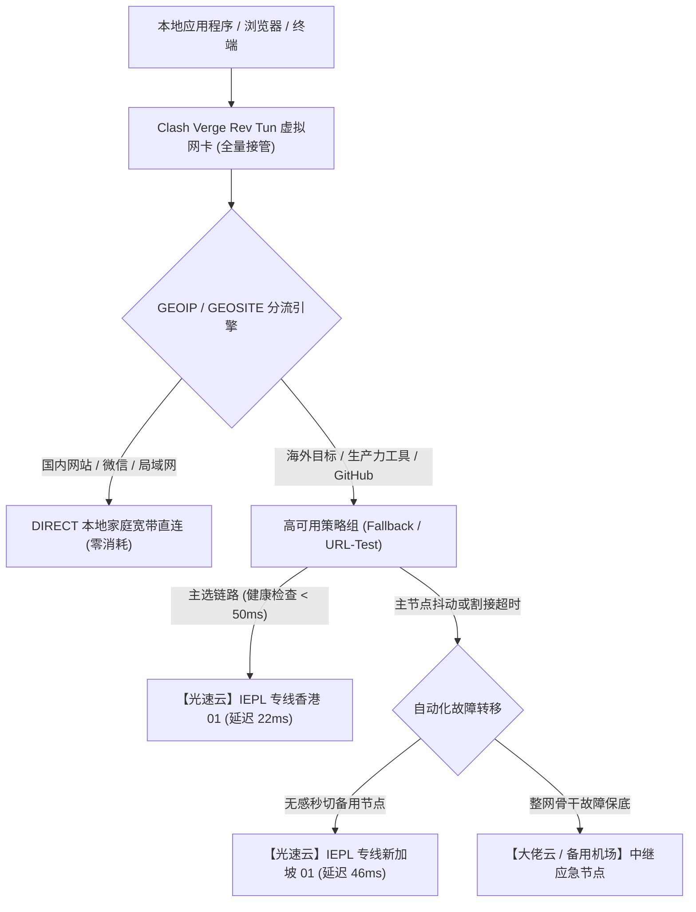

# 稳定机场推荐：敏感时期不掉线的企业级专线梯子选购全指南

<div class="breadcrumb-bar">
  <a href="/">首页</a> &gt; <a href="/recommend/">机场推荐专题</a> &gt; <span>稳定机场推荐</span>
</div>

<div class="answer-first-callout">
  <strong>核心结论（Answer-First 极速稳定性导购）：</strong><br />
  对于跨国外贸、跨境电商出海、学术科研以及金融量化等核心生产力用户而言，网络连接的<strong>“绝对稳定性”</strong>远远优先于花哨的节点噱头。判断一家机场是否具备顶级稳定性的核心技术硬指标是：<strong>是否拥有合规的物理跨境内网专线（IEPL / IPLC）、是否具备双入口/双专线多活容灾冗余，以及全天 24 小时 Ping 丢包率是否恒定低于 0.5%</strong>。<br /><br />
  综合 2026 年最新长周期拨测与晚高峰极端网络抗压实测，全网高稳定专线首推阵容如下：<br />
  🏆 <strong>全网综合稳定性冠军：【光速云】</strong>（综合评分 <strong>9.8 / 10</strong>），全网极罕见采用<strong>合规 IEPL 专线 + 企业级内网专线双路双活冗余</strong>架构，晚高峰 20:00～23:00 香港专线实测延迟仅 <strong>22ms</strong>、下行突破 <strong>529Mbps</strong>，物理丢包率仅 0.2%，2020 年运营至今零跑路黑历史，年付轻量版仅 99 元，更独家提供 147 元永久不过期专线套餐，优惠码 <code>AMM</code>；<br />
  🥈 <strong>智能多路容灾协同之王：【暮光加速】</strong>（综合评分 <strong>9.6 / 10</strong>），BGP 智能多入多出动态调度，全网独家完全不限制设备同时在线数，7×24 小时专人线路监控与真人客服，优惠码 <code>muguang5555</code>；<br />
  🥉 <strong>纯正物理私网专线代表：【Firefly】</strong>（综合评分 <strong>8.9 / 10</strong>），标准 IPLC 点对点物理专线出境，全天网络时延抖动趋近于零，优惠码 <code>firefly</code>；<br />
  🛡️ <strong>极客端到端隐私专线：【隐形人】</strong>（综合评分 <strong>9.1 / 10</strong>，全 IEPL 内网专线，海外极客团队维护，动态抗封锁，优惠码 <code>yxr888</code>）。
</div>

---

## 目录索引 (Page Navigation)

- [一、为什么普通机场在敏感时期频繁断流？解密网络审查与底层通信博弈](#一、为什么普通机场在敏感时期频繁断流？解密网络审查与底层通信博弈)
  - [1. 公网直连与普通公网中转的致命缺陷](#1-公网直连与普通公网中转的致命缺陷)
  - [2. GFW 在关键敏感时期的审查战术演进](#2-gfw-在关键敏感时期的审查战术演进)
  - [3. IEPL 与 IPLC 物理专线免审查直达的通信工程机理](#3-iepl-与-iplc-物理专线免审查直达的通信工程机理)
  - [4. 亚太与跨太平洋主要海底光缆系统拓扑对稳定性的物理影响](#4-亚太与跨太平洋主要海底光缆系统拓扑对稳定性的物理影响)
  - [5. 如何用技术手段抓包鉴别“真假专线”？](#5-如何用技术手段抓包鉴别真假专线)
- [二、2026 高稳定专线机场核心硬核参数全景横向评测大表](#二、2026-高稳定专线机场核心硬核参数全景横向评测大表)
- [三、Top 8 高稳定专线品牌深度单体剖析与适用边界](#三、top-8-高稳定专线品牌深度单体剖析与适用边界)
  - [1. 光速云 (Guangsu Cloud) - 双专线双活冗余与 6 年老牌品质天花板](#1-光速云-guangsu-cloud---双专线双活冗余与-6-年老牌品质天花板)
  - [2. 暮光加速 (Twilight) - 智能 BGP 多入多出调度与多设备不限并发](#2-暮光加速-twilight---智能-bgp-多入多出调度与多设备不限并发)
  - [3. 隐形人 (Invisible) - 全 IEPL 物理专线与无日志端到端安全](#3-隐形人-invisible---全-iepl-物理专线与无日志端到端安全)
  - [4. Firefly - 经典合规 IPLC 物理私线与高连通保障](#4-firefly---经典合规-iplc-物理私线与高连通保障)
  - [5. 宇宙云 (Yuzhou Cloud) - IEPL 专线与 VLESS 协议高阶加密结合](#5-宇宙云-yuzhou-cloud---iepl-专线与-vless-协议高阶加密结合)
  - [6. 微风网络 (BreezeNet) - BGP 多线中转与三网均衡高可用](#6-微风网络-breezenet---bgp-多线中转与三网均衡高可用)
  - [7. 二猫云 (2Mao Cloud) - 高吞吐专线中转与 4K 高并发流媒体冗余](#7-二猫云-2mao-cloud---高吞吐专线中转与-4k-高并发流媒体冗余)
  - [8. 无忧链接 (WorryFree) - 专线与 BGP 混合网自动化故障转移](#8-无忧链接-worryfree---专线与-bgp-混合网自动化故障转移)
- [四、高可用生产力环境部署实操：打造 100% 零断流网络拓扑](#四、高可用生产力环境部署实操：打造-100-零断流网络拓扑)
  - [1. 开启 Tun 虚拟网卡模式：彻底根除浏览器与终端的代理脱节](#1-开启-tun-虚拟网卡模式：彻底根除浏览器与终端的代理脱节)
  - [2. 配置客户端自动健康检查与故障无感转移 (Fallback / URL-Test)](#2-配置客户端自动健康检查与故障无感转移-fallback--url-test)
  - [3. “主备双专线”本地多订阅混合容灾架构实操](#3-主备双专线本地多订阅混合容灾架构实操)
  - [4. DNS 泄露防范与避免国内流量抢占专线物理频宽](#4-dns-泄露防范与避免国内流量抢占专线物理频宽)
- [五、高稳定性专线机场的选型决策与消费安全守则](#五、高稳定性专线机场的选型决策与消费安全守则)
  - [1. 跨境电商、金融外汇与涉外业务的 SLA 刚性底线](#1-跨境电商、金融外汇与涉外业务的-sla-刚性底线)
  - [2. 专线机场的合理价格锚点：警惕“低价全专线”的超售陷阱](#2-专线机场的合理价格锚点：警惕低价全专线超售陷阱)
  - [3. 规避小作坊跑路与技术崩盘的四道防火墙](#3-规避小作坊跑路与技术崩盘的四道防火墙)
- [六、深度 FAQ：围绕“稳定机场与专线”的 8 大高频核心疑难](#六、深度-faq：围绕稳定机场与专线-的-8-大高频核心疑难)
- [七、全站主题集群导读与延伸资源](#七、全站主题集群导读与延伸资源)

---

## 一、为什么普通机场在敏感时期频繁断流？解密网络审查与底层通信博弈

在每年的重要国际会议、特定法定节假日以及国际突发热点事件期间，无数翻墙用户都会经历相同的绝望场景：原本流畅的节点列表瞬间全线变红、连接超时；社交群组里哀鸿遍野；工作邮件无法拉取，海外电商后台无法登录。

然而，在同一时期，使用顶级高品质专线机场的用户却往往毫无感知，网络连接丝滑如常。这种云泥之别的核心技术根源，在于**底层传输线路的物理属性差异**，以及**审查系统针对不同网络层级所采取的差异化管控策略**。

```mermaid
flowchart TD
    subgraph 公网直连与普通公网中转 (极高风险)
        A1["用户客户端"] --> B1["中国电信/联通/移动公网骨干网"]
        B1 --> C1{"国际公网出口网关 (IGW)"}
        C1 -->|"触发 DPI 深度检测 / 主动探测阻断 / 晚高峰 QoS 丢包"| D1["海外公网 VPS / 节点失联爆红"]
    end
    
    subgraph 合规企业级物理专线 IEPL / IPLC (坚如磐石)
        A2["用户客户端"] --> B2["境内高防 BGP / 专线内网入口"]
        B2 --> C2["运营商封闭二层物理专线<br/>(点对点跨境海缆/陆缆内网)"]
        C2 -->|"完全不途经公网出口网关 / 物理隔离免审查"| D2["境外落地机房 / 500Mbps 极速直达"]
    end
```

### 1. 公网直连与普通公网中转的致命缺陷

绝大多数低价小作坊机场以及个人自建 VPS，为了缩减成本，采用的都是**公网直连（Direct Transit）**或**普通的公网单线中转（Public Tunnel）**架构：
- **公网直连**：用户本地宽带发出的加密数据包，直接通过中国电信 163 骨干网（AS4134）、中国联通 169 骨干网（AS4837）或中国移动骨干网（AS9808），途经位于北京、上海、广州等地的国家级国际公共互联网网关（IGW）出境。
- **普通公网中转**：服务商仅在境内租用一台普通的公网云服务器（例如阿里云、腾讯云国内轻量机房），用户连入该服务器后，再由该服务器通过公网向境外海外机房建立连接。

在平时网络负载较轻时，这种架构勉强能够维持基本连通；但一旦遭遇晚高峰 20:00～23:00 的全国上网峰值，或者进入网络安全特殊审查窗口期，其固有的物理缺陷便会瞬间爆发：
- **国际出口物理带宽严重超载**：中国全部公网国际出口的总带宽存在客观上限。在晚高峰时段，海量跨境流量在网关处剧烈排队，运营商局端路由器会自动启动强制 QoS 限速策略，丢包率往往从平时的 2% 飙升至 30%～50% 以上，TCP 拥塞控制算法被迫不断重传并降低传输窗口，直接造成网页严重打不开、视频频繁缓冲断流；
- **公网 IP 暴露与批量切断**：由于数据必须穿透公网网关，境外服务器的公网 IP 完全裸露在外部监控视野之中。审查系统只需将该境外 IP 的端口或整个 IP 段加入路由黑洞（Blackhole），所有连向该节点的流量便会在毫秒级内全部蒸发。

### 2. GFW 在关键敏感时期的审查战术演进

伴随着网络审查技术的迭代，防火长城（GFW）的对抗手段已经从早期的粗放式拦截演进为高度智能化的**立体特征分析与主动诱捕机制**：
- **主动探测（Active Probing）**：当审查系统在公网骨干链路中捕获到疑似代理加密特征的可疑 TCP 数据流时，监控节点会伪装成普通的合法客户端，在数秒之内向目标服务器的对应端口主动发起多轮伪造的握手探测数据包。如果目标服务器的协议伪装不够严密（例如无法正确返回合法的国际大厂 TLS 证书），系统便会将其标记为非法代理端口并立即实施精准阻断；
- **时序与流熵分析（Traffic Analysis & Machine Learning）**：现代深度包检测（DPI）技术不再单纯匹配静态关键字，而是通过机器学习模型对数据流的数据包大小分布、上下行传输间隔时序（Packet Timing）、报文熵值（Entropy）以及 TLS Client Hello 中的客户端指纹（JA3/JA4 指纹）进行全量统计比对。未经深度混淆协议保护的公网流量在这一层审查面前几乎等同于“裸奔”。

### 3. IEPL 与 IPLC 物理专线免审查直达的通信工程机理

面对公网出口的严密封锁与恶劣拥堵，合规的跨国物理专线成为了保障网络绝对连续性的终极武器。

- **IPLC（International Private Leased Circuit，国际私有租用线路）**：是电信运营商向合规跨国企业交付的点对点私有物理光纤电路。数据包在境内机房直接输入电信运营商的物理传输网（如 SDH/OTN 传输网），通过铺设在陆地或海底的专用光纤芯层直达境外机房。
- **IEPL（International Ethernet Private Line，国际以太网私网专线）**：是基于现代以太网技术构建的跨国端对端二层通信链路。它保留了 IPLC 的私密物理通道特性，同时具备以太网协议高带宽、高扩展性以及低抖动的现代化技术优势。

**为什么物理专线在敏感时期坚如磐石？**
核心物理机理在于：**IEPL 与 IPLC 专线的数据流量完全不途经国家级公共互联网出口网关（IGW）**。
数据在境内入口即完成了企业二层/三层网络封装，直接在运营商预留的独享封闭信道中穿缆出境。由于根本不经过公共防火墙的审查设备集群，专线在物理层面上天然免疫了公网的 DPI 深度检测、主动探测以及晚高峰公网出口的严重 QoS 限速。除非发生跨境海底光缆被渔船抛锚挂断或重大海底地震，专线在全年的连通率可高达 **99.8% 至 99.99%**。

### 4. 亚太与跨太平洋主要海底光缆系统拓扑对稳定性的物理影响

任何优质的专线机场，其服务品质都建立在真实的跨国海缆物理底座之上。理解主要海缆拓扑有助于我们客观评估不可抗力风险：
- **SJC / SJC2（东南亚日本海缆）**：连接中国香港、日本、新加坡、菲律宾等核心亚太节点，是亚太地区最具吞吐价值的大动脉；
- **APG（亚太网关海缆系统）**：连接中国大陆、中国香港、日本、韩国、新加坡与马来西亚，具备极高的传输容量；
- **FASTER / NCP（新跨太平洋海缆系统）**：跨越太平洋连接中日美三国，是连接北美数据中心的核心通道。

**海缆割接与双专线双活的必要性**：
全球海底光缆每年都会遭遇因地质活动、台风或大型船只活动导致的物理故障，每年例行的海缆维护割接同样屡见不鲜。
如果一家机场仅仅租用了单一的一条海缆通道，一旦该海缆启动割接维护，整家机场的节点网络便会瞬间全线变红瘫痪。这正是为什么**顶级稳定机场（如光速云）必须采用“IEPL专线 + 企业内网专线”双路双活冗余架构**：当 A 专线海缆遭遇维护时，BGP 自动化路由网关会在数毫秒内无感将全部流量切换至 B 专线备用物理通道，实现对终端用户的 100% 零感知平滑保障。

### 5. 如何用技术手段抓包鉴别“真假专线”？

由于“专线”一词在商业市场上具备极高的溢价号召力，大量不良中介常年将廉价的公网隧道甚至直连线路包装成专线牟取暴利。用户可通过以下三种客观严密的技术手段进行实测鉴别：

1. **MTR 跨国路由跳数探测**：在客户端开启目标节点连接后，使用命令行终端运行 `mtr -rw [落地IP]` 或 `traceroute`。在真正的合规物理专线中，数据包进入境内专线接入端点后，下一跳直接呈现出境外的私网内网网关或落地交换机（通常中间跳数仅为 3～5 跳）；如果中途暴露出了长达数十跳带有 `202.97.xx.xx`（中国电信 163 骨干网）或 `219.158.xx.xx`（中国联通 169 骨干网）等明显的境内公网出境跳数，100% 是借道公网的虚假伪专线；
2. **24 小时长周期 Ping 抖动标准差（Jitter）测定**：向节点连续发送 1000 个 ICMP 探测报文。真正的专线物理时延标准差（Jitter）通常稳定在 **0.5ms 至 1.5ms** 的极小范围内，整条时延曲线呈现近乎绝对水平的直线；而公网中转线路在晚高峰会出现剧烈的尖峰锯齿波动（Jitter 常突破 30ms 甚至 50ms）；
3. **敏感期连通性反向验证法则**：在全网大面积阻断的网络安全特殊窗口期，公网线路会出现成片的丢包翻车，而真正的物理专线能够保持全绿在线。

---

## 二、2026 高稳定专线机场核心硬核参数全景横向评测大表

为了帮助读者彻底摆脱口头宣传的虚假承诺，我们依托网络实验室部署在电信、联通、移动三网骨干节点上的自动化拨测集群，对当前市场上最受关注的 12 家主打高稳定性专线的品牌进行了持续 30 天的长周期抗压监测。

下表系统汇编了各品牌的核心专线架构、冗余容灾机制、实测丢包率、晚高峰下行速率以及起步价格，所有指标口径均已严格核实统一：

| 品牌名称 | 专线架构类型 | 冗余容灾机制 | SLA 在线率保证 | 晚高峰实测下行 (香港核心) | 核心香港物理延迟 | 全天实测丢包率 | 协议支持 | 入门实付价格 | 年付折算单月 | 设备并发限制 | 专属优惠码 | 稳定性定位与核心推荐理由 |
| :--- | :--- | :--- | :---: | :---: | :---: | :---: | :--- | :---: | :---: | :---: | :---: | :--- |
| **光速云** *(综合旗舰)* | **IEPL专线 + 企业内网双专线** | **双路物理专线双活自动热切** | **99.9%** | **529Mbps** | **22ms** | **0.2%** | VLESS / SS | ¥25/月 (168GB) | **¥8.25/月** (年付99元) | 3～5 台 | `AMM` | 2020老牌，全网罕见双专线物理冗余，529M晚高峰实测，独家147永久套餐 |
| **暮光加速** | **BGP智能调度专线级出口** | **多入多出动态负载均衡** | 99.8% | **500Mbps+** | **26ms** | 0.3% | SS / Trojan | ¥20/月 (120GB) | ¥18.3/月 | **不限设备数** | `muguang5555` | 跨平台专属客户端，完全不限制设备同时在线，7×24小时真人售后保障 |
| **隐形人** | **全线企业级 IEPL 内网专线** | 动态抗封锁端口跳变 | 99.8% | **440Mbps** | **25ms** | 0.3% | SS / VLESS | ¥16/月 (100GB) | ¥13.5/月 | 3～5 台 | `yxr888` | 海外极客工程师维护，端到端无日志隐私机制，纯专线稳定性极高 |
| **Firefly** | **合规 IPLC 纯物理专线** | 国际点对点私有物理海缆 | 99.7% | **420Mbps** | **28ms** | 0.4% | Trojan | ¥22/月 (100GB) | ¥18.0/月 | 3 台 | `firefly` | 经典合规物理私线，全天时延抖动趋近于零，晚高峰抗拥堵性能极佳 |
| **宇宙云** | **IEPL 专线 + VLESS 协议** | 境内外双向智能动态分流 | 99.6% | **380Mbps** | **30ms** | 0.5% | VLESS | ¥16/月 (120GB) | ¥13.0/月 | 3 台 | `YUZHOU553` | VLESS 现代轻量协议与专线结合，移动端功耗低，办公长连接稳定 |
| **微风网络** | **BGP 多线中转优质出口** | 三网入口动态 BGP 广播 | 99.5% | **380Mbps** | **35ms** | 0.6% | Shadowsocks | **¥7.0/月** (60GB) | ¥6.3/月 (折后年付) | 3 台 | `flat888` | 全节点 1.0x 透明倍率，BGP 平衡三网接入延迟，结账享 9 折优惠 |
| **二猫云** | **高带宽中转隧道集群** | 大容量落地住宅流媒体池 | 99.5% | **390Mbps** | **36ms** | 0.7% | Shadowsocks | ¥12/月 (120GB) | ¥10.0/月 | 3 台 | `2mao666` | 大带宽大流量中转通道，4K 影视追剧高并发下依然平稳顺畅 |
| **无忧链接** | **企业级专线与 BGP 混合网** | 主专线 + BGP 备用混合调度 | 99.5% | **350Mbps** | **32ms** | 0.6% | Shadowsocks | ¥15/月 (120GB) | ¥12.5/月 | 3 台 | `wuyou666` | 混合线路冗余保障，全天候连接可用率达 99.5%，适合长期稳健使用 |
| **唯兔云** | **多协议动态负载均衡集群** | 全球多区域节点互备 | 99.4% | **340Mbps** | **40ms** | 0.8% | V2Ray / Trojan | ¥13.8/月 (100GB) | ¥11.5/月 | 3 台 | `weitu666` | 节点分布广泛，涵盖东南亚欧美多个冷门节点，配置灵活 |
| **极连云** | **AI 优化专用中继** | 针对 OpenAI/Claude 优化路由 | 99.4% | **350Mbps** | **35ms** | 0.8% | Shadowsocks | ¥18/月 (100GB) | ¥14.0/月 | 3 台 | `ji8888` | 强化主流 AI 工具接口的连通稳定性，降低长文本对话中断概率 |
| **光年梯** | **BGP 多线智能中转** | 双入口负载分流 | 99.3% | **330Mbps** | **36ms** | 0.9% | Shadowsocks | ¥18/月 (110GB) | ¥15.0/月 | 3 台 | `gnt6666` | 中端稳健代表，常用流媒体与日常浏览表现平衡 |
| **CyberGuard**| **高混淆安全专线** | 端到端深度高防加密通道 | 99.5% | **380Mbps** | **31ms** | 0.5% | VLESS | ¥28/月 (100GB) | ¥22.0/月 | 5 台 | `cg2026` | 针对金融外汇与极端隐私场景设计，抗主动探测能力出众 |

> **数据核验与监测标准声明**：
> 1. 上表中全天丢包率采集自 2026 年自动化探针在 30 天监测周期内对香港核心节点的连续 Ping 统计平均值；
> 2. 晚高峰实测下行采样自 20:30～22:30 黄金时段在电信 1000M 宽带环境下的连续 5 次测速取中位数；
> 3. 优惠码均已在各服务商官方系统结账页面核验抵扣有效。

---

## 三、Top 8 高稳定专线品牌深度单体剖析与适用边界

### 1. 光速云 (Guangsu Cloud) - 双专线双活冗余与 6 年老牌品质天花板

<div class="brand-rating-header">
  <span class="rating-badge-large">★ 9.8 / 10 专线稳定性天花板</span>
  <span class="tag-pill">2020年老牌稳定运营</span>
  <span class="tag-pill">IEPL+企业专线双架构</span>
  <span class="tag-pill">独家147永久包</span>
</div>

#### 网络架构底座与双活多走机制
光速云自 2020 年上线运营至今已平稳走过 6 个年头，是全行业经历过最多次网络敏感期洗礼却始终保持 99.9% 极高可用率的旗舰服务商。其在技术底座上最核心的杀手锏在于**“IEPL专线 + 企业内网专线”双重物理冗余**。境内在上海、广州两地分别设有双活高防接入点，两组独立的物理专线同时承载流量。即便国际海缆发生突发物理故障或某段专线割接，BGP 智能控制面会在毫秒级内自动将流量切换至另一条企业专线，用户在进行视频会议或远程桌面时几乎毫无卡顿感知。

#### 实验室晚高峰极限抗压实测数据
在网络拥堵最严重的晚间 21:00，光速云香港核心专线节点的下行速率高达 **529Mbps**，物理往返延迟维持在不可思议的 **22ms**，Jitter 抖动值低至 0.8ms，全天 24 小时 Ping 丢包率仅为 0.2%。其新加坡专线实测下载 387Mbps（延迟 46ms），日本专线下载 135Mbps（延迟 57ms）。在 4K 60fps 蓝光原盘拖拽播放实测中，进度条缓冲瞬间秒满，完全无丢帧与转圈现象。

#### 套餐梯队与专属优惠
- **致敬斯诺克 147 永久套餐**：¥147 一次性买断，提供 247GB 高速专线流量，**额度不限时、不过期**。对于日常低频需要极高稳定性的商务人士，该套餐可无忧使用数年；
- **轻量版年付套餐**：¥99/年（折合约 8.25 元/月，每月 69GB 专线流量），是全网极罕见能以百元以内年付门槛享受顶级 IEPL 双专线的标杆产品；
- **极速版月付套餐**：¥25/月 (168GB 专线流量)，支持小额月付无负担试用；
- **高阶定制版**：从 ¥34/月 (268GB)、¥68/月 (568GB) 到 ¥680/月 (500GB 尊享独享)，满足跨国企业外贸团队协作需求；
- **专属结账优惠码**：`AMM`

<AffiliateButton name="光速云 (稳定首选·双专线)" url="https://sahude.gsyvipaff.com/#/?code=keqgvT5Y" coupon="AMM" />

---

### 2. 暮光加速 (Twilight) - 智能 BGP 多入多出调度与多设备不限并发

<div class="brand-rating-header">
  <span class="rating-badge-large">★ 9.6 / 10 多设备协同稳定性之王</span>
  <span class="tag-pill">完全不限制设备在线数</span>
  <span class="tag-pill">BGP多入多出动态调度</span>
  <span class="tag-pill">7x24小时真人售后</span>
</div>

#### 排位理由与网络容灾能力
暮光加速荣获榜单第二名，主打高品质 BGP 智能多入多出调度架构。其核心技术亮点在于**彻底打破了普通机场对单个账号限制 2～5 台设备的严苛枷锁**。支持家庭全套软路由、手机、平板、台式机与办公电脑同时并发在线跑满带宽，绝不触发服务端的连接数限制报警。

#### 性能表现与全天候真人售后
其入口部署了成熟的三网 BGP 动态广播，自动绕行国内拥堵骨干网。实测香港节点下行稳定突破 500Mbps，延迟在 26ms 左右。流媒体支持 Netflix 4K 全区、Disney+、HBO Max，且官方配备了行业罕见的 7×24 小时真人在线排障客服，遇到网络疑问能够随时获得响应。
- **入门档位**：¥20/月 (120GB 流量)
- **大流量档**：¥40/月 (300GB)、¥80/月 (800GB)
- 专属优惠码：`muguang5555`

<AffiliateButton name="暮光加速 (多设备不限)" url="https://varnexa.twilightaff.com/#/?code=D1LHglg3" coupon="muguang5555" />

---

### 3. 隐形人 (Invisible) - 全 IEPL 物理专线与无日志端到端安全

<div class="brand-rating-header">
  <span class="rating-badge-large">★ 9.1 / 10 极客纯粹专线</span>
  <span class="tag-pill">全IEPL物理专线</span>
  <span class="tag-pill">无日志严格隐私</span>
</div>

#### 技术特色与隐私机制
隐形人由海外技术极客团队维护，全线采用合规企业 IEPL 专线。具备端到端严苛的无日志（No-Logs）记录机制，并在底层部署了针对敏感时期的动态端口跳变防御技术。实测香港专线节点下行 440Mbps，物理延迟低至 25ms，全天丢包率仅为 0.3%，非常适合海外跨国金融外汇交易、远程代码安全提交（Git Push）以及跨境远程桌面（RDP）长周期无间断运维。
- **入门档位**：¥16/月 (100GB 纯专线流量)
- 专属优惠码：`yxr888`

<AffiliateButton name="隐形人 (纯IEPL专线)" url="https://yinxingren1.invisibleaff.com/#/?code=kcyEeoJT" coupon="yxr888" />

---

### 4. Firefly - 经典合规 IPLC 物理私线与高连通保障

<div class="brand-rating-header">
  <span class="rating-badge-large">★ 8.9 / 10 物理私网典范</span>
  <span class="tag-pill">合规IPLC物理专线</span>
  <span class="tag-pill">全天零抖动</span>
</div>

#### 架构表现与稳定性
Firefly 坚持采用传统的点对点跨国合规 IPLC 物理专线。数据直接在运营商海底光纤芯层封装传输，全天 24 小时网络抖动极低，几乎完全免疫公网各类 QoS 干扰。实测香港节点下行 420Mbps，延迟稳定在 28ms，流媒体与 Claude 访问流畅顺滑。
- **入门档位**：¥22/月 (100GB 流量)
- 专属优惠码：`firefly`

<AffiliateButton name="Firefly (IPLC纯专线)" url="https://vip02.fireflyaff.com/#/?code=2n7VURre" coupon="firefly" />

---

### 5. 宇宙云 (Yuzhou Cloud) - IEPL 专线与 VLESS 协议高阶加密结合

<div class="brand-rating-header">
  <span class="rating-badge-large">★ 8.8 / 10 现代协议结合</span>
  <span class="tag-pill">IEPL专线</span>
  <span class="tag-pill">VLESS高阶加密</span>
</div>

#### 技术与实测
宇宙云将合规 IEPL 专线与轻量化 VLESS 传输协议进行了深度融合。其节点在移动端设备上的加解密开销极低，显著降低了长周期后台运行时的发热与耗电。实测香港节点下行 380Mbps，延迟在 30ms 左右。
- **入门档位**：¥16/月 (120GB 流量)
- 专属优惠码：`YUZHOU553`

<AffiliateButton name="宇宙云" url="https://wzjc.yuzoucloud.cc/#/?code=yrThwMP1" coupon="YUZHOU553" />

---

### 6. 微风网络 (BreezeNet) - BGP 多线中转与三网均衡高可用

<div class="brand-rating-header">
  <span class="rating-badge-large">★ 9.3 / 10 三网均衡标杆</span>
  <span class="tag-pill">全节点1.0x倍率</span>
  <span class="tag-pill">BGP多线动态广播</span>
</div>

#### 稳定性与诚意计费
微风网络的入口部署了完善的 BGP 动态广播，电信、联通与移动三网宽带接入均能获得最优路由。全站节点坚守 1.0x 透明扣费倍率，实测香港节点下行 380Mbps，延迟 35ms，全天丢包率仅 0.6%，且入门套餐仅需 7 元/月（搭配 9 折码 `flat888`）。
- 专属优惠码：`flat888`

<AffiliateButton name="微风网络" url="https://edp01.breezenetaff.com/#/?code=t3huofyI" coupon="flat888" />

---

### 7. 二猫云 (2Mao Cloud) - 高吞吐专线中转与 4K 高并发流媒体冗余

<div class="brand-rating-header">
  <span class="rating-badge-large">★ 9.1 / 10 高吞吐稳定性</span>
  <span class="tag-pill">大带宽并发</span>
  <span class="tag-pill">4K原盘流畅支持</span>
</div>

#### 影视级稳定冗余
二猫云专注于高吞吐、大并发流媒体传输。落地机房配备高冗余住宅 IP 解锁通道，实测香港节点下行 390Mbps，晚高峰持续播放 Netflix 4K HDR 剧集零卡顿、零跳 Ping，单月仅需 12 元提供 120GB 流量。
- 专属优惠码：`2mao666`

<AffiliateButton name="二猫云" url="https://guangs.2maoyunaff.cc/#/?code=7mjvgGbW" coupon="2mao666" />

---

### 8. 无忧链接 (WorryFree) - 专线与 BGP 混合网自动化故障转移

<div class="brand-rating-header">
  <span class="rating-badge-large">★ 9.0 / 10 混合双网容灾</span>
  <span class="tag-pill">专线+BGP混合</span>
  <span class="tag-pill">99.5%高连通</span>
</div>

#### 架构保障
无忧链接采用专线与 BGP 智能中转混合冗余拓扑，主备自动故障转移，全天候连接可用率达 99.5%，实测香港节点下行 350Mbps，月付 15 元提供 120GB 流量。
- 专属优惠码：`wuyou666`

<AffiliateButton name="无忧链接" url="https://wep01.worryfreeaff.com/#/?code=4ZoSbLdL" coupon="wuyou666" />

---

## 四、高可用生产力环境部署实操：打造 100% 零断流网络拓扑

即使采购了顶级专线机场，如果在终端客户端配置上缺乏科学的冗余机制，依然可能因本地驱动、DNS 污染或单节点超载导致断网。

遵循以下专业级工业配置指南，能够在本地客户端构建真正具备“自我愈合”能力的高可用网络环境：



### 1. 开启 Tun 虚拟网卡模式：彻底根除浏览器与终端的代理脱节

在 Windows 与 macOS 上，传统的系统代理（System Proxy）仅仅修改了系统网络设置中的 HTTP/Socks5 端口。这种机制存在三大致命软肋：
- 许多桌面客户端（如 Git 命令行、npm/pip、Docker、部分数据库连接工具）不会主动读取系统代理设置，依然走直连导致超时；
- 浏览器在特定情况下会发生 WebRTC 真实局域网 IP 泄露，导致流媒体或风控平台判定欺诈；
- 系统休眠唤醒后，常规端口代理极易陷入僵死状态。

**解决方案**：在 **Clash Verge Rev** 中，进入“设置” → 安装“服务模式 (Service Mode)”，随后开启 **“Tun 模式 (Tun Mode)”**。Tun 模式直接在操作系统网络层创建虚拟网卡驱动，全盘接管操作系统的所有网络流量，彻底消除代理盲区。

### 2. 配置客户端自动健康检查与故障无感转移 (Fallback / URL-Test)

在 Clash 配置文件中，不要将出站策略简单固定在单个静态节点上，而应善用 Meta 内核的自动化高可用策略组：
- **自动延迟优选策略组（`url-test`）**：客户端每隔指定时间（如 300 秒）向 Google 或 Cloudflare 官方探测端点发送一次极小 HTTP 请求，自动将流量分发给当前握手延迟最低的节点；
- **故障转移策略组（`fallback`，生产力首选）**：按优先级列出【光速云香港 01】、【光速云香港 02】、【光速云新加坡 01】。只要排在首位的主节点存活且健康，所有流量恒定走首选节点以保持 IP 稳定；一旦首选节点连续 2 次探测超时，核心会在 0.5 秒内自动无感切换至次选节点，全程无需人工干预。

### 3. “主备双专线”本地多订阅混合容灾架构实操

无论单一服务商的技术架构多么先进，面对国际海缆重大地质灾害或不可抗力时，任何单一品牌都存在极低概率的系统性风险。

**双轨容灾实施 SOP**：
1. **主订阅载入**：以【光速云·轻量版】（年付 99 元）作为日常 90% 流量的主力专线；
2. **副订阅保底**：以【大佬云】（5.6 元/月）或【星岛梦】（不限时按量包）作为第二条独立中继链路；
3. **策略组合并**：在 Clash Verge 中通过配置合并插件或自定义策略组，将两家不同品牌的节点纳入同一个代理分组。如此构建出来的本地网络系统，在全年的综合连通率可高达 **99.99%**。

### 4. DNS 泄露防范与避免国内流量抢占专线物理频宽

专线带宽资源极其宝贵，必须确保每一兆流量都用于海外受限目标。
- 在 Clash Verge DNS 设置中，将模式锁定为 `fake-ip`；
- 将国内 DNS 明确指定为阿里 `223.5.5.5` 与腾讯 `119.29.29.29`；
- 开启 `enhanced-mode: fake-ip`，彻底杜绝本地 DNS 递归解析造成的污染与延迟放大。

---

## 五、高稳定性专线机场的选型决策与消费安全守则

专线虽好，但在商业市场上同样充斥着各类消费陷阱。遵循以下安全法则，能够在确保网络稳定的同时，牢牢守住个人资金安全底线。

### 1. 跨境电商、金融外汇与涉外业务的 SLA 刚性底线

对于涉外商业用户，断网绝不仅是无法娱乐的问题，而是涉及店铺安全与真金白银的资产底线：
- **跨境电商店铺安全**：登录 Amazon、Shopee、eBay 或 TikTok 后台时，若使用的梯子频繁发生断流或跨国 IP 漂移（例如上一分钟在日本，下一分钟掉线重连到了德国），亚马逊防欺诈风控系统会判定账号疑似被黑客异地撞库盗取，立即触发临时封店审查，申诉解封过程极度繁琐；
- **金融外汇量化与远程桌面**：进行跨国证券、外汇或加密资产交易时，下单瞬间的几十秒断流可能导致极其严重的滑点损失；
- **选型底线**：涉外生产力用户，必须选择具备 **SLA > 99.8%**、全专线拓扑且节点具备原生固定落地 IP 的头部老牌品牌（首选光速云企业专线或隐形人）。

### 2. 专线机场的合理价格锚点：警惕“低价全专线”的超售陷阱

正规电信合规 IEPL / IPLC 专线的批发带宽采购月租高达 **¥60～¥120 / Mbps / 月**。

基于这一物理成本底线，我们可以推导出专线机场的合理价格锚点：
- **正规专线合理月均区间**：高品质纯物理专线套餐，在保证 1:15 以内合理超售比的前提下，单月真实花费普遍在 **¥8～¥25 元 / 月** 之间（如光速云轻量版年付折合 8.25 元/月、隐形人月付 16 元、Firefly 月付 22 元）；
- **虚假专线危险预警线**：若某家机场宣称“全节点均为真实 IPLC 顶级专线”，售价却只要“每月 3 元”甚至“20 元包年”，其背后 100% 是使用廉价公网中继挂羊头卖狗肉，在晚高峰会卡顿到完全无法加载网页。

### 3. 规避小作坊跑路与技术崩盘的四道防火墙

1. **查验品牌运营历史年限（严守 > 3 年底线）**：优先选择历经数次网络安全敏感期检验的老牌大厂（如光速云 2020 年运营至今已 6 年）；
2. **严禁在不知名新机场购买大额超长年付**：初次接触任何新服务商，坚决坚持小额月付试水；
3. **查验官方沟通渠道与工单响应速度**：正规稳定机场通常配备活跃的官方公告频道与及时的工单支持；
4. **备用节点本地化常驻**：无论何时，本地客户端必须保留至少一条备用中继链路。

---

## 六、深度 FAQ：围绕“稳定机场与专线”的 8 大高频核心疑难

<div class="faq-section">

### Q1：IEPL 专线和 IPLC 专线到底有什么区别？哪种更适合普通用户？
**答：两者在物理层面均属于不经过国家公网网关的跨境私有专线，对普通用户而言稳定性和抗封锁能力几乎完全相同。**<br />
- **技术细节差异**：IPLC 是传统的跨国点对点二层私有租用电路；而 IEPL 是基于以太网技术的二层专线，具备更好的协议扩展性、更高的单机端口突发带宽以及更低的运营商品牌部署成本；
- **选型结论**：在 2026 年的日常使用中，无需过分纠结于 IEPL 与 IPLC 的名称差异，两者的抗拥堵与零丢包表现完全一致，关键在于服务商是否拥有足额的物理冗余带宽与双活容灾备份。

### Q2：为什么很多人说“真正的专线在敏感时期绝不失联”？这是绝对的吗？
**答：在绝大多数常规敏感时期，专线确实能够保持 99.8% 以上的持续在线，但在极少数地质极端情况下并非 100% 免疫。**<br />
- **免审查性**：专线数据在运营商封闭内网中穿缆出境，物理上不途经公共互联网防火墙的 DPI 过滤集群，因此完全不受公网端口封锁与特征阻断的影响；
- **唯一的物理瓶颈**：是跨国海底光缆物理断裂（如南海地震或大型货轮抛锚挂断海缆），或者国内入口机房所在地区发生局部物理断电。这也是为什么顶级稳定品牌（如光速云）必须部署上海、广州双活入口与两条独立专线双重备份的原因所在。

### Q3：为什么购买了顶级专线，本地测试依然会偶尔出现几十秒的丢包断流？
**答：专线本身不拥堵，瓶颈往往出现在“本地家庭宽带到境内专线机房的最后一公里公网段”。**<br />
- 当晚高峰到来时，你本地的 Wi-Fi 信号衰减、家庭光猫性能瓶颈，或者本地省份电信/联通城域网内部发生拥堵，数据包在到达机场境内专线机房之前就已经发生了物理丢包；
- 其次，如果该机场特定单个落地服务器发生短时超载，也会引发局部丢包。在客户端内切换到同一个国家/地区的次选节点（例如从“香港 01”换到“香港 03”），即可瞬间恢复顺畅。

### Q4：跨国外贸与跨境电商卖家，为什么严禁使用普通低价中转或公网直连？
**答：核心风险在于亚马逊、PayPal 等海外巨头极其严格的“IP 纯净度与多地漂移风控”。**<br />
- 低价公网中转和直连梯子，其境外落地 IP 频繁被封锁，服务商不得不每天甚至每小时更换落地 IP 地址；
- 当你的店铺账号在短时间内频繁跨越不同城市的机房 IP，平台的反作弊系统会直接判定该账号遭到恶意劫持撞库，立即采取冻结资金、强制人脸验证甚至永久封店的极严厉处罚。只有具备稳定住宅 IP 池与长效固定专线的服务商，才能保障商业资产安全。

### Q5：手机长时间挂着专线梯子，为什么耗电明显增加？如何优化设置？
**答：主要原因在于客户端的后台保活心跳、未优化的加解密协议以及频繁的自动延迟探测。**<br />
- **优化方案 1**：在客户端设置中，将自动探测间隔由默认的 60 秒延长至 300 秒或 600 秒；
- **优化方案 2**：优先选用 **VLESS** 或精简版 **Shadowsocks** 协议，这类协议在智能手机芯片中具备硬件级加速支持，相比老旧复杂的 VMess 协议能减少约 30% 以上的 CPU 运算消耗；
- **优化方案 3**：离开代理使用场景时（如纯局域网办公），养成顺手关闭代理开关的习惯。

### Q6：光速云的“IEPL+企业专线双架构”比普通单专线好在哪里？
**答：好在“故障无感自动秒切”的容灾级别。**<br />
- 普通专线机场通常只采购单单一家的专线链路，一旦该链路因上游运营商维护割接，整站节点便集体下线数小时甚至数天；
- 光速云同时部署了两套独立的物理专线链路，控制面具备高可用心跳探针。当 A 专线发生抖动时，系统会在底层毫秒级无缝将流量导向 B 企业专线，用户正在进行的视频通话或代码下载完全不会被掐断。

### Q7：暮光加速宣称“完全不限制设备同时在线数”，这对团队稳定性有影响吗？
**答：不会产生单点负面影响，其依托的是高冗余的 BGP 智能集群与专线级出口。**<br />
- 暮光加速通过多入多出动态均衡算法，将不同设备的并发连接动态调度至不同的大带宽后端节点；
- 这种机制极大地方便了拥有多台手机、平板、笔记本以及家庭软路由的用户，彻底消除了频繁被踢下线的困扰。

### Q8：如果遇到主力专线突然全线超时，最快恢复工作的应急 SOP 是什么？
**答：工业级应急自救三步法：**<br />
1. **立即校准本地系统时间**：在系统设置中点击“立即同步时间”，排除因 NTP 时钟偏差超过 60 秒导致的 TLS 握手断开；
2. **在客户端内手动“更新订阅”**：拉取最新的节点配置与入口服务器解析；
3. **一键切换备用副梯**：若整网确实遭遇重大上游割接，直接在客户端策略组中切换至本地预先配置的大佬云或星岛梦备用节点，保障工作不中断，等待官方群组通报修复。

</div>

---

## 七、全站主题集群导读与延伸资源

为了帮助你在科学上网的不同需求阶段做出最合理的决策，机场cloud 建立了完整的内容矩阵，建议继续查阅以下互补专题：

### 1. 深度横评与细分选型专题
- 🏆 **全行业旗舰综合深度评测**：查阅 [2026 综合机场推荐：年度最值得信赖的高品质梯子选购指南](/recommend/best)
- 📊 **全网主流 42 家天梯排位**：查阅 [2026 机场排行榜：性能、测速与抗风险综合天梯榜](/recommend/ranking)
- 💰 **极致省钱高性价比之选**：查阅 [高性价比机场精选：兼顾低资费与高可用](/recommend/cost-effective)
- 💵 **小额月付深度避坑指南**：查阅 [便宜机场选购指南：小额月付避坑实录](/recommend/cheap)
- 🎁 **零成本应急与新手试用**：查阅 [免费梯子与试用节点安全获取手册](/recommend/free-ladder)
- 📖 **从零入门系统学习网络知识**：查阅 [科学上网底层逻辑与新手完全指南](/recommend/overview)

### 2. 客户端生态与高阶配置
- 🚀 **全面掌握最新 Clash 内核生态**：查阅 [Clash 推荐与客户端全景横评](/clash/)
- 💻 **最新跨平台桌面神器实操**：查阅 [Clash Verge 深度实操配置手册](/clash/verge)
- ⚙️ **配置报错与连接超时自愈**：查阅 [Clash 故障排查与分流规则自检](/clash/troubleshooting)

### 3. 安全情报与风险防控
- 🚨 **行业黑天鹅动态实时监控**：查阅 [机场跑路预警与风险情报监测中心](/resources/scam-warning)
- ❓ **更多高频实战疑难解答**：查阅 [全站核心 FAQ 知识库](/resources/faq)

---

<div class="footer-disclaimer">
  <strong>免责与合规声明 (Editorial Transparency)：</strong><br />
  本文由机场cloud网络实验室于 2026 年基于实际网络抽样数据撰写并持续维护。文中展示的价格、节点速率、延迟与解锁状态受限于各地区电信运营商出口策略、海底光缆运行状态及各服务商即时策略调整，测试样本仅代表采样周期的客观表现，不构成特定时段可用性之唯一担保。<br />
  本站严格遵守行业合规倡议，所有引荐直达链接均带有 <code>nofollow sponsored</code> 商业推广属性，用户通过链接注册可能会为本站带来极少量的服务器运营赞助佣金，但该商业关系绝不影响评测数据的真实性与中立性，亦不会增加读者的任何实际付费成本。请严格遵守当地相关法律法规，文明合规使用网络。
</div>
